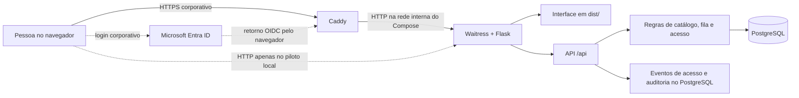

# Agenda de espaços — Costa do Sauípe & Rio Quente

**Estado em 14/10/2026:** piloto local funcional e implantação Docker Compose preparada para Linux, ainda sem homologação no servidor corporativo. A agenda permite consultar espaços, registrar solicitações, administrar a fila e controlar bloqueios por dia inteiro de **01/01/2026 a 31/12/2028**. O backend Flask serve a interface e a API; o PostgreSQL é a fonte oficial dos dados. O Waitress executa a aplicação. Não é necessário um servidor Node.js para operá-la.

O projeto atende às equipes **Comercial MICE** e **Operacional**. Cada pessoa possui uma conta, uma equipe, um escopo por empreendimento e responsabilidades adicionais quando autorizada. A implantação compartilhada e o login real pelo Microsoft Entra ID ainda dependem de infraestrutura e homologação corporativas. A agenda não está integrada ao Opera Cloud.

## Navegação deste documento

- [Estado da entrega](#estado-da-entrega)
- [Arquitetura e tecnologias](#arquitetura-e-tecnologias)
- [Versionamento e compatibilidade](#versionamento-e-compatibilidade)
- [Funcionalidades e regras de negócio](#funcionalidades-e-regras-de-negócio)
- [Fluxos detalhados de uso](#fluxos-detalhados-de-uso)
- [Modelo de dados](#modelo-de-dados)
- [Banco PostgreSQL para infraestrutura](#banco-postgresql-para-infraestrutura)
- [Autenticação, autorização e segurança](#autenticação-autorização-e-segurança)
- [Matriz de permissões](#matriz-de-permissões)
- [API e respostas](#api-e-respostas)
- [Executar neste computador](#executar-neste-computador)
- [Executar com Docker no Linux](#executar-com-docker-no-linux)
- [Rotina de implantação e atualização](#rotina-de-implantação-e-atualização)
- [Preparar outra instalação](#preparar-outra-instalação)
- [Operar a agenda](#operar-a-agenda)
- [Pessoas e responsabilidades](#pessoas-e-responsabilidades)
- [Relatórios](#relatórios)
- [Backup e recuperação](#backup-e-recuperação)
- [Testar](#testar)
- [Estrutura e preservação](#estrutura-e-preservação)
- [Implantação compartilhada](#implantação-compartilhada)
- [Limites conhecidos e critérios de aceite](#limites-conhecidos-e-critérios-de-aceite)

## Estado da entrega

| Parte | Situação atual |
| --- | --- |
| Agenda e solicitações | Implementadas e testadas com PostgreSQL; uso local do piloto. |
| Catálogo | 125 linhas de origem importadas, resultando em 99 espaços/configurações. Os empreendimentos foram classificados; a composição física continua a validar. |
| Acesso local | Em uso no piloto: conta e senha individuais, sessões revogáveis e histórico de acesso. |
| Acesso corporativo | Fluxo OIDC com PKCE implementado e retorno simulado testado. Falta registrar a aplicação no tenant, vincular as identidades e homologar o login real. |
| Relatórios e backup | Consulta, CSV, impressão/PDF via navegador, backup e restauração PostgreSQL implementados. |
| Infraestrutura compartilhada | Docker Compose com aplicação, PostgreSQL persistente e proxy HTTPS preparado. Pendente: servidor e domínio corporativos, credenciais Entra, coleta central de logs, monitoramento, rotina de backup e política de retenção. |

Os dois empreendimentos estão identificados: **90 configurações da Costa do Sauípe** e **9 do Rio Quente**. Essa classificação registra a localização administrativa, mas **não homologa a composição física** de salas ou módulos. Uma área hachurada na agenda significa “a validar”; um dia vazio, por si só, não garante disponibilidade. A origem e as decisões de classificação estão em [docs/ANALISE-LISTA-SALAS.md](docs/ANALISE-LISTA-SALAS.md) e nos arquivos de classificação em `docs/`.

## Arquitetura e tecnologias



O navegador carrega arquivos HTML, CSS e JavaScript de `dist/`. O JavaScript consulta a API e envia alterações como JSON. O servidor valida identidade, permissões e regras de negócio antes de gravar. Os dados da agenda ficam no PostgreSQL; `localStorage` é reservado a preferências de exibição. A aplicação oferece `GET /health` para verificar resposta do servidor e conexão com o banco.

**Organização interna:** `api_catalog.py`, `api_schedule.py` e `api_people.py` recebem as rotas HTTP por domínio. `catalog.py`, `bookings.py` e `people.py` aplicam as regras e gravam alterações; `calendar_queries.py` monta as leituras de disponibilidade e grade; `auth.py`/`entra.py` cuidam da identidade; `db.py` controla conexões, transações e migrações. Na interface, `storage.js` concentra chamadas à API, `calendar-model.js` reúne funções de apresentação sem dependência do navegador, `calendar-views.js` monta as telas e `calendar.js` coordena formulários, navegação e ações. As regras de autorização e conflito permanecem no servidor.

| Componente | Versão / papel |
| --- | --- |
| Projeto | `0.1.0` em `pyproject.toml`; identificação interna do piloto, sem homologação de produção. |
| Python | Compatibilidade declarada `>=3.12,<3.14`. Testes passaram em **3.12.4** e **3.13.16** neste computador. |
| Flask | **3.1.3**, fábrica de aplicação, páginas e API. |
| Waitress | **3.0.2**, servidor WSGI do piloto. |
| PostgreSQL | **14.18** validado no piloto local; imagem Docker **17.11** para novas instalações, testada com catálogo e backup. A passagem de uma base 14 para 17 exige migração planejada por backup/restauração, nunca reaproveitamento direto do volume. |
| Imagens Docker | Python **3.13.16** (Debian Trixie), PostgreSQL **17.11** (Trixie) e Caddy **2.10.2**. |
| psycopg com binário | **3.3.6**, conexão e consultas PostgreSQL. |
| Authlib | **1.8.0**, cliente OpenID Connect para o Entra ID. |
| Requests | **2.32.5**, dependência direta do cliente de autenticação. |
| Poetry | Configuração compatível com Poetry 2; **2.5.1** usado para gerar e testar `poetry.lock`. |
| pytest | **9.1.1**, grupo de desenvolvimento. |
| Node.js | **20.16.0** disponível neste computador para testes JavaScript legados; a versão não está fixada para implantação e não participa do servidor da agenda. |

As dependências diretas estão fixadas em `pyproject.toml` e `requirements.txt`. O `poetry.lock` fixa também as dependências indiretas para instalações com Poetry. O projeto usa o modo `package-mode = false`: instalar dependências não publica nem instala a agenda como pacote Python.

## Versionamento e compatibilidade

`0.1.0` é a versão declarada da aplicação, **não** um número de release homologada. Até esta revisão, o repositório não possui tag de release. O código está no Git; cada implantação deve registrar o commit ou tag aprovado, a data, as versões das imagens efetivamente usadas e a versão do esquema registrada em `public.schema_migrations`. Alterações de interface e backend são entregues juntas pela imagem da aplicação. O diretório `legacy/` preserva o painel anterior para consulta e não é outra versão do banco atual.

As migrações SQL são ordenadas pelo nome (`001`, `002`, `003`) e aplicadas uma única vez, em ordem; não edite uma migração já executada em um ambiente. Para uma alteração futura do modelo, crie outro arquivo numerado e teste a atualização de uma cópia do banco antes do deploy. A aplicação Docker aplica as migrações ao iniciar; portanto, **subir uma nova imagem pode modificar o banco antes do primeiro acesso à página**. Faça backup antes de cada atualização e trate a reversão do banco separadamente da reversão do código.

O Dockerfile fixa as versões das **dependências diretas** em `requirements.txt` e usa as tags de imagem mostradas acima. O build com `pip` ainda pode resolver versões indiretas mais novas; `poetry.lock` só governa instalações feitas com Poetry. Para uma release totalmente reproduzível, a equipe deve congelar também as dependências indiretas da imagem e os digests das imagens base. Python 3.12/3.13 é a faixa do projeto; a imagem entregue executa **Python 3.13.16**. Não monte um volume de dados do PostgreSQL 14 diretamente no container 17: migre por backup/restauração planejados.

## Funcionalidades e regras de negócio

| Tela / função | O que oferece |
| --- | --- |
| **Calendário** | Grade mensal e lista, filtros por empreendimento e situação, pesquisa, indicação de pendências e de ocupação efetiva. No celular, inicia em lista. |
| **Consultar disponibilidade** | Exibe por espaço/período as solicitações pendentes, a fila, a ocupação confirmada e, quando a composição foi validada, as opções físicas disponíveis. |
| **Solicitações & fila** | Criação, consulta, edição e cancelamento de solicitações; ordem de entrada; promoção manual para opção prioritária e confirmação pelo responsável da fila. |
| **Salas & espaços** | Consulta da fonte, classificação por empreendimento/localização, revisão da importação e validação da composição física com registro de evidência. |
| **Pessoas & acessos** | Contas individuais, equipe, escopo, responsabilidades, ativação/desativação, exclusão de acesso e histórico de autenticação para administradores. |
| **Relatórios** | Filtros por período, empreendimento, situação e pesquisa; CSV e impressão, com opção de salvar PDF no navegador. |

Uma **solicitação** contém evento/motivo, responsável, observações e de **1 a 40 alocações**. Cada alocação relaciona uma configuração de espaço, uma fase (`montagem`, `evento` ou `desmontagem`), datas e, se validada, uma opção de recursos físicos. As datas apresentadas ao usuário incluem o último dia; internamente o banco guarda o fim exclusivo, o que simplifica conflitos entre intervalos. Fases repetidas ou sobrepostas não criam dupla ocupação para o mesmo recurso e dia.

| Situação | Efeito e condição principal |
| --- | --- |
| **Pendente de validação** | Registra a demanda mesmo sem composição física homologada; não ocupa recursos nem pode receber opção prioritária. |
| **Em espera** | Entra na fila com composição física válida; não ocupa recursos. |
| **Em opção prioritária** | Concedida manualmente pelo responsável da fila após revalidar prioridade e disponibilidade integral; ocupa recursos. |
| **Confirmado** | Reserva aprovada pelo responsável da fila; ocupa os recursos conhecidos. Excepcionalmente, uma configuração ainda não validada pode ser confirmada sem recursos mapeados: a própria configuração fica bloqueada no período, mas conflitos com outras composições dependem da futura validação física. |
| **Cancelado** | Libera a ocupação e conserva o registro e o histórico; uma nova negociação requer outra solicitação. |

A prioridade considera a **interseção de recursos físicos e dias**, além da mesma configuração. Uma solicitação anterior que permanece integralmente disponível não pode ser ultrapassada por outra que disputa seus recursos. A fila não promove nem expira registros automaticamente. Mudanças de espaços, períodos ou fases de uma espera atribuem uma nova posição; edição apenas de texto preserva a posição. A confirmação é atômica: se uma parte conflitar, nenhuma parte é reservada. A chave única `(resource_id, day)` em `occupations` oferece uma segunda proteção contra dupla ocupação.

O catálogo preserva os 125 códigos da lista recebida. Os códigos **5 e 6** são serviços e ficam fora da agenda. As **28 variantes da Arena Sauípe** são rastreadas sob quatro configurações de uso; não representam 28 salas independentes. A importação recusa mudanças silenciosas em códigos existentes, pode mostrar prévia e não duplica registros. A classificação e a validação da topologia física são operações distintas, com histórico e controle de versão.

**Exemplo do fluxo:** uma pessoa de Comercial MICE registra evento, espaço e períodos de montagem, evento e desmontagem. Se a composição ainda não foi homologada, a solicitação fica pendente de validação e visível para a equipe, sem prometer disponibilidade física. Após a operação validar os recursos e as combinações permitidas, a solicitação pode entrar em espera. O responsável da fila verifica as solicitações anteriores e a ocupação de todos os dias/recursos, concede a opção prioritária e confirma quando autorizado. O bloqueio aparece no calendário e nos relatórios; uma eventual edição ou cancelamento fica no histórico.

## Fluxos detalhados de uso

### Entrada e navegação

1. Ao abrir a página, o navegador consulta `GET /api/session`. Sem sessão válida, mostra a entrada local do piloto ou o botão **Entrar com Microsoft**, conforme `CALENDAR_AUTH_MODE`. No modo local, a primeira conta só pode ser criada pelo navegador quando a base está vazia, a origem é loopback e `CALENDAR_ALLOW_LOCAL_SETUP=1`; no Docker, o primeiro administrador é criado por comando administrativo. No modo Entra, a pessoa precisa estar previamente vinculada na agenda.
2. Após o login, o navegador carrega o catálogo permitido para a conta e os dados da tela aberta. A navegação reúne **Calendário**, **Solicitações & fila**, **Salas & espaços**, **Relatórios** e, apenas para `can_manage_users`, **Pessoas & acessos**. A ausência de um botão é uma conveniência visual; a API confere novamente cada permissão.
3. A interface oferece atualização manual e consulta novamente o servidor a cada **20 segundos** quando não há formulário aberto nem campo em edição. Se a conexão falhar, sinaliza que os dados podem estar desatualizados e não informa que um salvamento foi concluído sem confirmação do servidor. Formulários com alterações não salvas pedem confirmação antes de fechar, navegar ou recarregar a página.

### Calendário, disponibilidade e solicitações

| Passo | Comportamento |
| --- | --- |
| Consultar o calendário | Escolha mês entre 2026 e 2028, empreendimento, situação e pesquisa. A grade exibe um dia por coluna; a lista mostra solicitações. No celular a lista é o modo inicial. O filtro de situação modifica a lista de solicitações, mas **não oculta ocupação efetiva** da grade. |
| Interpretar um dia | Hachura indica composição física ainda não validada; ponto cheio, ocupação; meio ponto, algumas opções de composição ocupadas; contador amarelo, demandas pendentes ou em espera. Abrir um dia mostra solicitações visíveis e pode informar que existe ocupação cujos detalhes estão fora do escopo da pessoa. |
| Consultar disponibilidade | Informe primeiro e último dia. O resultado separa pendências e espera dos períodos em opção/confirmados. Composição não validada aparece como **a validar**, e a disponibilidade de uma opção física é calculada no período completo. Essa consulta não concede prioridade nem reserva o espaço. |
| Criar solicitação | Informe evento, responsável, situação, observações e de **1 a 40** alocações. Cada alocação pede empreendimento, espaço filtrado, fase, início e último dia. A equipe proprietária e o autor vêm da sessão, não do formulário. Se houver composição homologada, selecione uma das opções físicas permitidas. É possível adicionar espaços ou fases à mesma solicitação. |
| Acompanhar a fila | **Solicitações & fila** apresenta os registros pela ordem de entrada, com filtros por empreendimento, situação e pesquisa. O número da fila é definido no banco. A solicitação em espera não ocupa o espaço; o responsável da fila promove ou confirma manualmente após a verificação integral de conflitos. |
| Abrir e alterar | **Consultar** mostra situação, equipe, responsável, períodos, composição, número da fila e histórico. A equipe proprietária pode editar ou cancelar com motivo; o responsável da fila pode promover/confirmar registros de outra equipe no seu escopo, mas não editar o evento nem cancelá-lo. |

Uma solicitação **pendente** pode ser criada sem composição física validada; ela não bloqueia nada. Para colocá-la **em espera**, cada alocação precisa ter uma composição homologada. A validação posterior do catálogo não muda automaticamente a situação de solicitações antigas. Somente `can_schedule` pode conceder **opção prioritária** ou **confirmar**. A confirmação de uma configuração ainda não validada é uma exceção operada por essa pessoa: impede outra opção/confirmação da configuração exata no período, mas a segurança contra sobreposição com configurações relacionadas depende do mapeamento físico futuro.

| Transição atual | Quem pode executar | Efeito |
| --- | --- | --- |
| Criar `pending` ou `waiting` | Pessoa da equipe | Registra a demanda; `waiting` exige composição validada. |
| Criar diretamente `confirmed` | Pessoa com `can_schedule` | Revalida fila e conflitos e bloqueia o conjunto todo; confirmação sem topologia exige sua responsabilidade. |
| `pending` → `waiting` | Equipe proprietária | Passa a concorrer na fila após validação física. |
| `waiting` → `option` | Pessoa com `can_schedule` | Revalida ordem e disponibilidade e ocupa recursos físicos. |
| `pending`/`waiting`/`option` → `confirmed` | Pessoa com `can_schedule` | Confirma todos os períodos em uma transação. |
| Editar ou retornar para `pending`/`waiting` | Equipe proprietária | Revalida dados; sair de `option` ou `confirmed` libera ocupações. Alterar alocações enquanto está `waiting` atribui nova posição na fila. |
| Cancelar | Equipe proprietária | Exige motivo, libera ocupações e preserva registro e histórico; não promove automaticamente outra solicitação. |

**Regra a homologar com a operação:** o código atual permite à equipe proprietária rebaixar uma solicitação `confirmed` para `waiting` ou `pending`, liberando seu bloqueio; em seguida ela pode alterar períodos/espaços como demanda não confirmada. Enquanto permanece `confirmed`, uma pessoa sem `can_schedule` não pode alterar suas alocações. Defina antes do uso compartilhado se esse rebaixamento deve continuar permitido. A confirmação posterior sempre volta a exigir `can_schedule`.

### Catálogo, pessoas e relatórios

- **Salas & espaços:** o catálogo mantém os códigos originais e dados técnicos como referência. A pessoa com `can_catalog` pode consultar as 125 linhas de origem, importar a lista JSON completa primeiro em prévia e depois com confirmação, classificar de 1 a 150 configurações por empreendimento/localização com motivo, cadastrar um recurso físico identificado pela operação e validar conjuntos permitidos com atestado e referência. A importação recusa alterações silenciosas de códigos existentes e não sobrescreve uma revisão prévia.
- **Validação física:** um recurso novo não fica validado automaticamente. Cada configuração aceita de 1 a 30 opções homologadas, cada uma com até 30 recursos; configurações com número de módulos declarado exigem esse tamanho por opção. Um espaço individual preserva sua identidade física. A topologia não pode ser substituída por outra enquanto houver solicitação `waiting`, `option` ou `confirmed` naquela configuração. O histórico cadastral exibe até 300 alterações recentes.
- **Pessoas & acessos:** `can_manage_users` vê as contas, adiciona pessoas, define equipe e escopo na criação, altera atividade/escopo/responsabilidades e exclui acessos. Alterar ou excluir revoga as sessões da pessoa. O administrador não altera nem exclui o próprio acesso pela interface. A consulta de autenticação mostra os 300 eventos recentes; a exclusão retira a conta da lista, mas preserva vínculos históricos e a auditoria anterior.
- **Relatórios:** use período, empreendimento, situação e pesquisa. A consulta considera alocações que **intersectam** o período, inclusive quando começaram antes dele. O CSV exporta uma linha por alocação encontrada, em UTF-8 com BOM e `;`; impressão/PDF usa o navegador. O relatório obedece ao escopo da conta e não substitui backup da base.

## Modelo de dados

As migrações `001_initial.sql`, `002_authentication.sql` e `003_user_deletion.sql` são aplicadas por `flask --app calendar_app init-db`. A tabela `schema_migrations` registra o que já foi executado. Não há SQLite nem armazenamento da agenda no navegador.

| Migração | Alteração principal |
| --- | --- |
| `001_initial.sql` | Empreendimentos, equipes, contas, fonte/catálogo, solicitações, alocações, ocupações, auditoria, idempotência e contadores de login. |
| `002_authentication.sql` | Vínculo Entra (`entra_tenant_id` + `entra_object_id`), sessões revogáveis e eventos de autenticação. |
| `003_user_deletion.sql` | Marca temporal `users.deleted_at` para retirada lógica de contas. |

| Tabelas | Conteúdo |
| --- | --- |
| `resorts`, `teams`, `users` | Empreendimentos, equipes, contas, escopos, responsabilidades e identidade corporativa vinculada. |
| `source_items`, `imports` | Códigos, texto e versão da lista recebida; rastreio da carga. |
| `configurations`, `resources` | Configurações reserváveis, recursos físicos e opções de composição validadas. |
| `bookings`, `allocations`, `occupations` | Solicitações, fases/períodos e ocupação por recurso/dia. |
| `audit` | Alterações de negócio e cadastro, com autor, horário, ação e dados anteriores/posteriores permitidos. |
| `idempotency` | Chaves de criação para evitar duplicação por reenvio da mesma solicitação. |
| `auth_sessions`, `auth_events`, `login_attempts` | Sessões revogáveis, eventos de segurança e contadores temporários de falhas de login. |

| Entidade/campos principais | Relação e uso |
| --- | --- |
| `resorts.id`, `teams.id` | Identificadores `cs`/`rq` e `commercial`/`operations`, referenciados pelo restante do modelo. |
| `users.id`, `username`, `team_id`, `scopes`, `can_*`, `active`, `version`, `deleted_at` | Conta e autorização locais. O vínculo corporativo usa `entra_tenant_id` + `entra_object_id`, com índice único quando preenchido. `password_hash` nunca é enviado na API. |
| `source_items.code`, `payload`, `configuration_id`; `imports.digest` | Rastreiam cada código e dado original da fonte e a carga executada. Serviços permanecem na fonte, sem configuração reservável. |
| `configurations.id`, `resort_id`, `source_codes`, `suggested_options`, `options`, `validated`, `version` | Configuração que pode ser solicitada. Sugestões não são homologação; `options` contém conjuntos físicos permitidos após revisão. Nome, grupo, localização, notas e dados técnicos também ficam aqui. |
| `resources.id`, `resort_id`, `validated`, `evidence`, `version` | Identidade dos módulos/recursos físicos; uma configuração pode usar um ou vários deles. |
| `bookings.id`, `queue_number`, `team_id`, `status`, `created_by`, `updated_by`, `version` | Evento e dono da equipe, ordem de entrada, estado e controle de edição simultânea. Título, responsável, notas e horários de criação/atualização também são persistidos. |
| `allocations.booking_id`, `configuration_id`, `phase`, `start_date`, `end_exclusive`, `resources` | Uma linha por espaço/fase/período da solicitação. O último dia mostrado é `end_exclusive - 1 dia`; `resources` guarda o conjunto escolhido quando homologado. |
| `occupations.resource_id`, `day`, `booking_id` | Ocupação efetiva por recurso/dia para opções e reservas confirmadas com recursos conhecidos; chave primária `(resource_id, day)`. |
| `audit.actor_id`, `entity_type`, `entity_id`, `action`, `before_data`, `after_data`, `note`, `occurred_at` | Trilha de mudanças de negócio/cadastro. A exclusão de acesso preserva esta tabela e seus dados anteriores. |
| `auth_sessions`, `auth_events`, `login_attempts`, `idempotency` | Revogação de sessão, eventos de segurança, limitação temporária de login e resposta idêntica para reenvio seguro de criação. |

Os períodos de reserva são **dias inteiros**, sem horário ou fuso horário na ocupação. Datas da API são `AAAA-MM-DD`; o usuário vê o último dia incluído, enquanto `allocations.end_exclusive` guarda o dia seguinte. Eventos e auditoria usam `timestamptz`; logs técnicos usam UTC, e a interface apresenta horários de histórico conforme o fuso do navegador em português do Brasil. Ampliar a agenda além de 2028 exige mudar validações no backend/interface e as restrições de data do banco por nova migração.

Escritas de negócio ocorrem em transação. O piloto serializa mutações com um bloqueio consultivo do PostgreSQL para revalidar fila, conflitos e topologia no momento de gravar. Registros editáveis usam campo `version`; se alguém os alterou desde a abertura do formulário, a API retorna `409` e pede recarga. Criações de solicitação exigem `Idempotency-Key`: repetir o mesmo envio devolve o mesmo resultado; reutilizar a chave com outro conteúdo é recusado.

## Banco PostgreSQL para infraestrutura

Na stack Compose entregue, o serviço `db` cria o banco **`calendario`** e o usuário **`calendario`**. A aplicação usa somente o schema **`public`**, definido por `DB_SCHEMA='public'` e por `SET search_path` em cada conexão. **Costa do Sauípe e Rio Quente são linhas de `public.resorts`, não schemas nem bancos distintos.** Não há extensão PostgreSQL exigida pelas migrações. Os schemas temporários criados por testes e pela prévia visual não são componentes da implantação. O nome do schema não é uma variável de ambiente do deploy atual; adotar um schema corporativo próprio exige ajuste e teste do código, das migrações, das permissões e do backup.

| Grupo | Tabelas em `public` | Finalidade |
| --- | --- | --- |
| Controle do esquema | `schema_migrations` | Nome e data de cada migração aplicada. |
| Cadastros e fonte | `resorts`, `teams`, `users`, `resources`, `configurations`, `source_items`, `imports` | Equipes, identidades, catálogo físico, classificação e origem dos dados. |
| Agenda | `bookings`, `allocations`, `occupations`, `idempotency` | Solicitações, períodos, bloqueios e proteção contra reenvio. |
| Segurança e histórico | `auth_sessions`, `auth_events`, `login_attempts`, `audit` | Sessões, eventos de acesso, limitação de login local e alterações de negócio. |

São **16 tabelas** após as três migrações. `bookings` registra o evento e sua posição na fila; `allocations` registra espaço, fase e intervalo com fim exclusivo; `occupations` tem chave primária `(resource_id, day)` para impedir ocupação duplicada do mesmo recurso no mesmo dia. `users.scopes` limita os empreendimentos consultáveis pela API. O banco não implementa isolamento por equipe via Row Level Security: o controle de escopo e responsabilidades ocorre na aplicação, por isso o acesso direto ao banco deve ser restrito.

O processo abre conexões `psycopg` com tempo limite de conexão de **5 segundos** e `statement_timeout` de **20 segundos**. O Waitress inicia com **6 threads** no container; não há pool externo de conexões configurado. Dimensionamento, limite de conexões, armazenamento, alta disponibilidade e ensaio de carga dependem da infraestrutura escolhida; não há números de capacidade homologados. `/health` faz `SELECT 1` e retorna erro se o banco estiver indisponível. O Compose usa um volume persistente `postgres_data` e não publica a porta 5432 no host.

Na configuração atual, **o mesmo usuário do banco aplica migrações e atende requisições**, porque `docker/run.py` executa `migrate()` a cada início. Em banco externo, esse usuário precisa poder criar/alterar tabelas, índices e sequências no schema durante a inicialização, além de ler e gravar os dados. Se a política exigir papéis separados de migração e operação, a equipe deve adaptar essa inicialização e testar os privilégios antes da produção; apenas trocar a senha ou reduzir os grants do usuário atual fará a aplicação falhar ao iniciar. O backup da aplicação usa `pg_dump --schema=public` e inclui dados e esquema, mas não papéis globais nem arquivos de segredos.

## Autenticação, autorização e segurança

### Modos de entrada

- **`local` (piloto atual):** usuário e senha individuais. Novas senhas têm 15 a 128 caracteres, são armazenadas somente como hash gerado pelo Werkzeug e passam por uma lista local inicial de senhas óbvias. O login limita a oito falhas por combinação de origem e usuário em uma janela de dez minutos. Não existe senha padrão. A primeira conta pode ser criada pelo navegador apenas no loopback e quando `CALENDAR_ALLOW_LOCAL_SETUP=1`.
- **`entra` (código preparado, ainda não homologado no tenant):** o navegador é redirecionado ao Microsoft Entra ID pelo fluxo OpenID Connect de código de autorização com PKCE `S256`. Authlib trata o retorno OIDC; a aplicação confere `nonce`, tenant, público e o identificador estável `tid` + `oid`. Só uma pessoa **ativa e previamente vinculada** recebe sessão local. O modo desativa login e troca de senha locais. A agenda não consulta o AD local por LDAP, não recebe senha corporativa e não decide a política de MFA do tenant.

O Active Directory corporativo poderá alimentar as identidades do Entra ID por sincronização gerida pela equipe de identidade. Essa sincronização fica fora deste projeto. A autenticação real com o tenant, a política de atribuição/grupos e o comportamento do logout do SSO precisam ser homologados antes da implantação compartilhada. Veja também [docs/AUTENTICACAO-E-LOGS.md](docs/AUTENTICACAO-E-LOGS.md).

No modo Entra, o diretório autentica a pessoa; a agenda decide se o par `tid` + `oid` está vinculado a uma conta local ativa e quais ações ela pode executar. Desativar alguém **somente no Entra** não revoga instantaneamente uma sessão já criada pela agenda: é necessário definir com a equipe de identidade como essa revogação será propagada ou desativar a conta na própria agenda. O logout da agenda encerra a sessão local, mas não garante a saída do SSO no navegador.

### Sessões e permissões

Após o login, a agenda gera um **token opaco aleatório**. O navegador o recebe em cookie `salas_auth` com `HttpOnly` e `SameSite=Lax`; `Secure` é obrigatório no modo Entra/HTTPS e fica desativado apenas no HTTP local do piloto. O PostgreSQL guarda somente o **hash do verificador**, o usuário, a versão de acesso, o último uso, o vencimento absoluto e a revogação. O token completo não é gravado no banco nem em `localStorage`. Um segundo cookie assinado do Flask (`salas_session`) guarda estado de formulário/CSRF e dados transitórios do fluxo OIDC; ele não substitui a verificação da sessão revogável no banco.

Os padrões atuais são **8 horas de duração absoluta** e **60 minutos sem atividade**, configuráveis. Em cada chamada à API, o servidor verifica token, hash, prazos, revogação, conta ativa e versão de acesso. Logout revoga a sessão no banco. Alterar o acesso ou desativar uma conta revoga suas sessões; trocar a senha local revoga as outras sessões da pessoa. Limpeza de sessões antigas e contadores de tentativa existe no comando `prune-auth`, mas precisa de agendamento operacional.

Escopo e responsabilidades são conferidos no servidor, independentemente dos botões visíveis na interface. A conta comum consulta os empreendimentos de seu escopo e edita/cancela apenas solicitações da própria equipe. `can_catalog` autoriza cadastro e topologia; `can_schedule` concede opção prioritária e confirmação; `can_manage_users` administra pessoas e acessos. O responsável da fila pode promover ou confirmar solicitações de outra equipe no escopo, mas não editar o evento ou cancelá-lo. Um administrador não altera o próprio acesso pela tela.

### Proteções de entrada, navegador e banco

- **SQL injection:** valores de usuário são passados como parâmetros separados às consultas `psycopg`; identificadores de esquema dinâmicos usam `psycopg.sql.Identifier`. Os testes incluem um título com texto de injeção e verificam que ele permanece dado, sem executar SQL.
- **CSRF:** toda operação mutável sob `/api/` exige `X-CSRF-Token` associado ao cookie de sessão do Flask e um objeto JSON válido. Cookies não substituem esse controle.
- **XSS e exportação:** os campos textuais vindos dos dados são escapados ao compor o HTML; o CSV prefixa células que poderiam ser interpretadas como fórmulas por planilhas.
- **Cabeçalhos HTTP:** a aplicação envia política de conteúdo (CSP), `X-Content-Type-Options: nosniff`, `X-Frame-Options: DENY`, política de referência e `Cache-Control: no-store`. Requisições têm `X-Request-ID`; o corpo aceito tem limite de 3 MB.
- **Concorrência:** transações, controle de versão, revalidação no salvamento e chave única de ocupação evitam reservas parciais e dupla ocupação conhecida.

Essas camadas foram testadas no piloto, mas não constituem uma auditoria de segurança externa nem substituem revisão de infraestrutura, proxy, permissões do banco e testes corporativos antes da exposição em rede.

### Registros e retenção

| Registro | Onde fica e como é usado |
| --- | --- |
| `auth_events` | PostgreSQL: entrada aceita ou recusada, limite de tentativas, início/retorno do SSO, saída, mudança de senha, vínculo de identidade, alteração de acesso e recusas `403`. Contém horário, tipo/resultado, usuário quando conhecido, IDs de sessão/requisição, motivo padronizado e hash da origem; não contém senha nem token completo. Administração consulta os 300 eventos mais recentes em **Pessoas & acessos → Histórico de acessos**. |
| `audit` | PostgreSQL: alterações de solicitações, catálogo e pessoas, com histórico por entidade. É separado do histórico de autenticação. |
| `login_attempts` | PostgreSQL: contadores temporários usados para limitar tentativas de senha local. |
| Log técnico | `app.logger` usa JSON com horário UTC, nível, mensagem, caminho e ID da requisição quando disponível; a hospedagem ainda precisa coletar, proteger e girar a saída do processo. |
| Entra ID | Eventos de senha, MFA e acesso condicional pertencem aos registros corporativos do provedor, sob gestão da equipe de identidade. |

Os logs técnicos da aplicação saem no fluxo do container e podem ser vistos com `docker compose ... logs app`; **não existe arquivo de log da aplicação em `instance/`** nem coleta central pronta. O Caddyfile atual também não configura um log HTTP de acesso por requisição. Se a equipe precisar dessa trilha, deve configurar o proxy/coletor e validar o tratamento dos dados pessoais. `X-Request-ID` correlaciona uma resposta HTTP com o evento de acesso e com logs técnicos gerados durante a requisição, quando houver. Eventos `auth_events` gravam um hash da origem observada pelo Flask; atrás do Caddy atual, `request.remote_addr` tende a ser o endereço do proxy, **não um identificador confiável do IP de cada pessoa**. Qualquer necessidade de IP real exige uma configuração explícita de proxy confiável e revisão de segurança no código.

O comando `prune-auth` elimina sessões expiradas/revogadas e contadores antigos **após um dia**; ele **não apaga `auth_events` nem `audit`**. Agende sua execução e registre o resultado. Retenção de eventos de acesso, auditoria, logs do proxy e backups, monitoramento/alertas, destino central de logs e acesso administrativo devem ser definidos com segurança e privacidade. O backup PostgreSQL inclui os eventos e históricos; não registre cookies, senhas, segredos do Entra ou corpos de requisição no coletor.

Não há expurgo automático de `bookings`, `allocations`, `audit`, `auth_events` ou `idempotency`. Confirmações históricas também permanecem registradas na base até que uma política de retenção seja implementada. Isso afeta crescimento de armazenamento e privacidade; a equipe deve aprovar prazos e um procedimento de descarte que preserve integridade referencial e evidências necessárias, em vez de apagar tabelas diretamente.

## Matriz de permissões

As três responsabilidades são **independentes**; atribuir uma não concede automaticamente as outras. A equipe (`commercial` ou `operations`) é definida na criação da conta, e o escopo contém Costa do Sauípe e/ou Rio Quente. A API exige que **todas as alocações** de uma solicitação estejam dentro do escopo da pessoa para mostrá-la; uma solicitação que cruza os dois empreendimentos exige acesso aos dois. Recursos físicos de uma composição também precisam estar no escopo. O servidor reavalia a conta ativa, versão e sessão em cada operação.

| Ação | Quem pode | Limite aplicado |
| --- | --- | --- |
| Consultar calendário, catálogo, disponibilidade, solicitações e relatórios | Qualquer conta ativa | Apenas configurações e solicitações inteiramente dentro do escopo. Um bloqueio fora do escopo pode aparecer como ocupação com detalhes restritos na grade. |
| Criar solicitação; editar ou cancelar uma existente | Qualquer conta ativa | Equipe proprietária e escopo; o servidor define equipe/autoria. Edição confirmada obedece às regras de situação e alocação descritas acima. |
| Conceder opção prioritária ou confirmar reserva | `can_schedule` | Pode atuar em outra equipe, desde que a solicitação inteira esteja no escopo; deve passar pela checagem de fila/conflitos. Não concede edição/cancelamento da outra equipe. |
| Consultar fonte, importar catálogo completo, classificar, cadastrar recurso, validar topologia, ver histórico cadastral | `can_catalog` | Classificação, recursos e topologia respeitam o escopo; a importação da lista completa e a consulta ao histórico cadastral são globais na base. |
| Criar, ativar/desativar, ajustar ou excluir pessoas; ver histórico de autenticação | `can_manage_users` | Administração de contas é global na base, não limitada ao escopo de consulta da própria pessoa. Não pode ajustar nem excluir o próprio acesso pela interface. |
| Trocar a própria senha | Pessoa autenticada no modo `local` | Exige senha atual; modo `entra` transfere a gestão de senha ao provedor corporativo. |

O primeiro administrador criado por `bootstrap-entra` recebe os dois empreendimentos e as três responsabilidades. Conceder `can_manage_users` a outra conta permite que ela designe novos administradores; a equipe deve controlar essa atribuição e revisar a trilha em `audit`/`auth_events`.

## API e respostas

A interface e a API usam a mesma origem. `GET /health` é público e consulta o PostgreSQL. `GET /api/session` também é público para informar modo de entrada, estado de configuração inicial e token CSRF. Os endpoints de login/retorno Entra seguem suas próprias regras; as operações de agenda, catálogo, pessoas, auditoria e relatórios exigem sessão válida. `/` e `/static/` entregam a interface; `/legacy/` preserva a página anterior para consulta.

| Método e rota | Acesso e efeito principal |
| --- | --- |
| `GET /api/session` | Estado da sessão, usuário quando autenticado, modo `local`/`entra`, CSRF e necessidade de primeiro cadastro. |
| `POST /api/setup` | Apenas modo local, base sem pessoas e acesso direto por loopback permitido; cria a primeira conta administradora. |
| `POST /api/login`, `POST /api/logout`, `POST /api/password` | Entrada local, revogação da sessão local e troca da própria senha no modo local. Login/troca local são recusados no modo Entra. |
| `GET /api/entra/login`, `GET /api/entra/callback` | Início e retorno OIDC no modo Entra; vínculo `tid` + `oid` e sessão local após validação. |
| `GET /api/catalog` | Configurações e recursos visíveis no escopo, número de linhas da fonte e empreendimentos. |
| `GET /api/catalog/sources`, `POST /api/catalog/import` | Fonte original e prévia/confirmação da importação; exigem `can_catalog`. |
| `POST /api/catalog/classify`, `POST /api/catalog/{id}/topology`, `POST /api/resources` | Classificação, homologação da composição e cadastro de recurso; exigem `can_catalog` e escopo adequado. |
| `GET /api/bookings`, `GET /api/bookings/{id}` | Lista filtrada ou detalhe com histórico da solicitação, dentro do escopo. |
| `POST /api/bookings`, `PUT /api/bookings/{id}` | Cria ou edita uma solicitação da equipe, com validação de datas, composição, situação, versão e conflitos. A criação exige `Idempotency-Key`. |
| `POST /api/bookings/{id}/promote`, `/confirm`, `/cancel` | Promoção/confirmação por `can_schedule`, ou cancelamento com motivo pela equipe proprietária; cada ação exige `version` atual. |
| `GET /api/availability` | Situação dos espaços e opções físicas no período, com pendências/espera separados de ocupações efetivas. |
| `GET /api/calendar` | Dados diários da grade; cada consulta cobre no máximo **62 dias**. |
| `GET /api/reports.csv` | Exportação filtrada de alocações, uma linha por período encontrado. |
| `GET/POST /api/users`, `PUT/DELETE /api/users/{id}` | Consulta, criação, ajuste e exclusão lógica de contas; exigem `can_manage_users`. |
| `GET /api/audit/catalog`, `GET /api/audit/auth` | Até 300 registros recentes do histórico cadastral ou de autenticação; exigem `can_catalog` ou `can_manage_users`, respectivamente. |

`GET /api/bookings`, `GET /api/calendar` e `GET /api/reports.csv` aceitam `from` e `to` em `AAAA-MM-DD`, `resort` (`all`, `cs`, `rq`; `unassigned` existe para administração de dados ainda não classificados), `status` (`pending`, `waiting`, `option`, `confirmed`, `cancelled`) e `search` (texto; o servidor considera no máximo 200 caracteres). Sem datas, o período padrão da consulta é **01/01/2026 a 31/12/2028**; a grade `/api/calendar` exige um recorte de até **62 dias**, portanto deve receber um mês ou intervalo curto. O filtro é por interseção com as alocações, não apenas por data inicial. A pesquisa ignora acentos e diferenças de caixa em evento, responsável, equipe e nome do espaço. O resultado de uma solicitação pode conter `matched_allocations`, a parte das suas alocações que satisfez os filtros. `GET /api/availability` usa o intervalo e o empreendimento; ele mostra pendências e ocupações independentemente dos filtros de situação e pesquisa. As datas devolvidas em JSON seguem ISO 8601.

Em `POST`/`PUT`/`DELETE` sob `/api/`, o cliente envia um **objeto JSON** e `X-CSRF-Token` obtido de `/api/session`; o limite do corpo é **3 MB**. Na criação de solicitação, `Idempotency-Key` deve ter de **8 a 100 caracteres**. Edições, exclusão de pessoa e transições enviam o inteiro `version` recebido na última consulta: uma versão antiga é recusada sem substituir o trabalho mais recente. Exemplo mínimo de criação pendente, com identificador de configuração obtido de `/api/catalog`:

```json
{
  "title": "Evento de exemplo",
  "responsible": "Equipe solicitante",
  "status": "pending",
  "notes": "",
  "allocations": [
    {
      "configuration_id": "space_004",
      "phase": "event",
      "start_date": "2026-12-01",
      "end_date": "2026-12-01",
      "resources": []
    }
  ]
}
```

O servidor ignora a escolha visual de empreendimento como autoridade: ele confere `configuration_id`, os recursos e o escopo no banco. `team_id`, autoria e posição da fila são preenchidos pelo servidor e não podem ser enviados para forçar outra equipe ou prioridade. Uma operação atômica que falha preserva o estado anterior.

| HTTP | Significado usual |
| --- | --- |
| `400` | Campo, data, filtro, JSON ou operação inválida. |
| `401` | Sessão ausente, vencida ou revogada; entrar novamente. |
| `403` | CSRF, escopo ou responsabilidade insuficiente. |
| `404` | Recurso inexistente ou rota indisponível no modo de autenticação atual. |
| `409` | Versão desatualizada, disputa por sala/dia, prioridade anterior ou mudança de estado não permitida. |
| `422` | Composição física exigida ou ainda não homologada. |
| `429` | Excesso de tentativas de login local. |
| `503` | PostgreSQL indisponível; o salvamento não foi confirmado. |

Erros retornam JSON com mensagem legível e, quando aplicável, detalhes; restrições internas do banco não são expostas ao navegador. Cada resposta tem `X-Request-ID` gerado pelo servidor. O CSV usa UTF-8 com BOM, separador `;` e neutralização de valores que poderiam virar fórmulas em planilhas.

## Executar neste computador

O ambiente Python e o banco local já foram preparados. Na pasta `painel`, caso o PostgreSQL local esteja parado:

```sh
pg_ctl -D instance/postgres -l instance/postgres.log -o '-h 127.0.0.1 -p 55432 -k /private/tmp' start
```

Inicie a aplicação:

```sh
.venv/bin/python serve.py
```

Acesse **http://127.0.0.1:4174**. Se a agenda já estiver aberta, não é necessário iniciar outro servidor. `Ctrl+C` encerra a aplicação; o banco permanece ativo. Para encerrar o banco dedicado, use `pg_ctl -D instance/postgres stop` quando não houver usuários conectados.

O banco do piloto já recebeu as três migrações. Antes da migração de autenticação, foi criado o backup local `instance/backups/pre-auth-2026-10-13.dump`; antes da migração de exclusão, `instance/backups/pre-user-deletion-2026-10-13.dump`. O diretório `instance/` e o arquivo `.env` são locais e ignorados pelo Git.

Em uma **base local vazia** com cadastro inicial habilitado, o primeiro acesso cria a conta individual de administração. A base atual do piloto já tem pessoas cadastradas; entre com a conta existente. Na criação de uma conta, escolha uma senha de 15 a 128 caracteres. Frases-senha, espaços e caracteres Unicode são aceitos; não há exigência de misturar tipos de caracteres. O piloto rejeita uma lista local inicial de senhas óbvias e a própria identificação do usuário; uma checagem ampla de credenciais vazadas depende de integração futura com serviço ou lista corporativa. A primeira conta administra cadastros, pessoas e fila; isso não permite editar/cancelar solicitações de outra equipe. Não existe `admin/admin123` na aplicação nova. Senhas já cadastradas continuam válidas no login até que seus titulares as alterem; a nova regra se aplica à criação e à troca de senha.

## Executar com Docker no Linux

Na pasta `painel`, o Docker Compose sobe o PostgreSQL e a aplicação em uma rede interna. A versão local publica a agenda somente em `127.0.0.1:4174`; a versão corporativa acrescenta o Caddy para HTTPS nas portas 80 e 443. O banco não publica porta no servidor. Instale Docker Engine com o plugin Compose e OpenSSL no Linux e reserve espaço persistente para os volumes. O build baixa as imagens e dependências Python; não exige Python, Poetry, Node ou PostgreSQL instalados no host.

### Inventário para infraestrutura

| Item | Configuração entregue / decisão necessária |
| --- | --- |
| Host | Linux com Docker Engine, plugin Compose e OpenSSL; `curl` é usado somente na verificação HTTP sugerida. É preciso permissão para executar Docker e espaço persistente para imagens, banco, certificados e backups. O Docker Desktop foi testado com containers Linux ARM64; ainda falta ensaio no servidor escolhido. |
| Entrada de rede | No modo corporativo, DNS do domínio apontando para o proxy e portas TCP **80/443** acessíveis conforme a política de certificados. O Compose não publica a porta da aplicação nem a **5432** do PostgreSQL no host. |
| Saída de rede | Build requer acesso às imagens e ao índice de pacotes Python. Em operação, o login OIDC precisa alcançar o Microsoft Entra ID por HTTPS; o Caddy precisa alcançar o emissor de certificados se usar TLS automático. Validar DNS, firewall e eventuais proxies corporativos antes da subida. |
| Serviços | `db` = PostgreSQL 17.11; `app` = Python 3.13.16 + Flask/Waitress; `proxy` = Caddy 2.10.2 apenas com `compose.prod.yaml`. `db` deve ficar saudável antes de `app`; `proxy` espera `app` saudável. |
| Persistência | `postgres_data` = dados do banco; `app_instance` = arquivos de backup gerados no container; `caddy_data` e `caddy_config` = estado/certificados do proxy corporativo. Não são backups externos. |
| Segredos | `secrets/db_password`, `secrets/calendar_secret_key`, `secrets/entra_client_secret` no host. Os dois primeiros são criados por `docker/init-secrets.sh`; o terceiro vem da equipe de identidade. `secrets/` e `.env.docker` são ignorados pelo Git. Preserve os segredos entre recriações da stack. |
| Identidade | Registrar aplicação web no tenant Entra, obter Tenant ID, Client ID, segredo e Object ID da primeira pessoa; cadastrar exatamente `https://SEU_DOMINIO/api/entra/callback` como URI de retorno. Decidir atribuição à aplicação, MFA e acesso condicional com a equipe de identidade. |
| Dados existentes | Decidir antes da primeira subida se o banco será novo ou se dados do piloto serão migrados. O banco criado pelo Compose é separado do PostgreSQL local; não haverá cópia automática dos dados do computador de desenvolvimento. |

O processo da aplicação roda como usuário **`calendar` (UID 10001)** dentro da imagem. A aplicação escuta `0.0.0.0:4174` **somente na rede interna do Compose** no modo corporativo; o Caddy recebe HTTPS e encaminha para ela. O Caddyfile atual usa certificado automático para o domínio informado. Caso o domínio seja apenas interno ou o certificado venha da organização, adapte e valide o Caddyfile antes de abrir o serviço. Expor diretamente a porta 4174 como HTTP não representa o modo corporativo documentado.

### Piloto local com containers

Execute uma única vez para criar dois segredos aleatórios. O script preserva os arquivos se já existirem:

```sh
sh docker/init-secrets.sh
docker compose -f compose.yaml -f compose.local.yaml up -d --build
docker compose -f compose.yaml -f compose.local.yaml ps
```

Abra **http://127.0.0.1:4174** no próprio servidor. Como o cadastro inicial pelo navegador só aceita acesso direto pelo loopback da aplicação, crie o primeiro administrador pelo terminal; o comando pedirá os dados e a senha sem exibi-la:

```sh
docker compose -f compose.yaml -f compose.local.yaml exec app python docker/run.py flask --app calendar_app create-user --admin
```

O volume `postgres_data` guarda a agenda. O volume `app_instance` guarda backups criados dentro do container. Na primeira subida de um banco vazio, a aplicação aplica as migrações, importa as 125 linhas do catálogo e as relações revisadas dos dois empreendimentos. Nas subidas seguintes, verifica as migrações e preserva classificações e alterações existentes. A base Docker é **separada** do PostgreSQL local deste computador; dados do piloto atual exigem backup e restauração planejados antes de uma migração.

Para acompanhar o estado e encerrar os serviços:

```sh
docker compose -f compose.yaml -f compose.local.yaml logs -f app
docker compose -f compose.yaml -f compose.local.yaml down
```

`down` conserva os volumes. Evite `down -v` se houver dados: essa opção remove os volumes do banco e da aplicação. Preserve também `secrets/` e mantenha cópias externas protegidas; trocar `secrets/db_password` depois que o banco foi criado não altera automaticamente a senha interna do PostgreSQL.

### Servidor Linux com HTTPS e Microsoft Entra ID

Use um checkout do **commit ou tag aprovado** e execute os comandos abaixo na pasta `painel`. Crie os dois segredos aleatórios e copie o exemplo de configuração **somente na primeira instalação**. Em `.env.docker`, substitua o domínio e os IDs pelo registro da aplicação web no tenant. Grave o **segredo do aplicativo Entra** em `secrets/entra_client_secret`, com permissão de leitura restrita ao administrador do servidor; não o coloque no Git, em `.env.docker` nem em comandos que apareçam no histórico do shell. A URL de retorno registrada no Entra deve ser exatamente `https://SEU_DOMINIO/api/entra/callback`.

```sh
sh docker/init-secrets.sh
cp .env.docker.example .env.docker
```

Edite `.env.docker` e crie `secrets/entra_client_secret` com o valor real. Antes de iniciar, confira domínio, IDs, existência dos três segredos, portas/DNS e o resultado da configuração Compose. O comando de verificação abaixo não imprime os valores dos segredos:

```sh
chmod 600 .env.docker secrets/entra_client_secret
docker compose --env-file .env.docker -f compose.yaml -f compose.prod.yaml config --quiet
docker compose --env-file .env.docker -f compose.yaml -f compose.prod.yaml up -d --build
docker compose --env-file .env.docker -f compose.yaml -f compose.prod.yaml ps
```

Na **primeira subida de um banco vazio**, o processo aplica as três migrações, importa 125 linhas da fonte e classifica 99 configurações: 90 da Costa do Sauípe e 9 do Rio Quente. O processo não cria pessoas automaticamente. Nas subidas seguintes, verifica migrações pendentes e mantém cadastros e alterações existentes; a importação inicial não reclassifica uma base já em uso. O Caddy obtém e renova o certificado HTTPS automaticamente quando o DNS do domínio aponta para o servidor e as portas 80/443 estão alcançáveis pelo emissor. Se a agenda estiver apenas em rede interna ou usar certificado da organização, a equipe de infraestrutura deve configurar esse certificado no proxy. Não use um domínio fictício para homologar o Entra ID.

Com a stack ativa, vincule a primeira pessoa administradora ao **Object ID** do Entra, ou vincule contas já restauradas conforme [Ativar o login corporativo](#ativar-o-login-corporativo):

```sh
docker compose --env-file .env.docker -f compose.yaml -f compose.prod.yaml exec app python docker/run.py flask --app calendar_app bootstrap-entra --username pessoa@empresa.com --name "Nome da pessoa" --team commercial --object-id UUID-DA-PESSOA
```

`bootstrap-entra` só aceita base sem pessoas e atribui à primeira conta os dois empreendimentos e as três responsabilidades administrativas. Em base restaurada do piloto, **não** use esse comando: vincule cada conta existente com `link-entra`, conforme [Ativar o login corporativo](#ativar-o-login-corporativo), para preservar IDs e histórico. Confirme o Object ID e a equipe de cada pessoa antes do vínculo; o e-mail serve como nome de usuário, mas a autenticação usa `tid` + `oid`.

```sh
docker compose --env-file .env.docker -f compose.yaml -f compose.prod.yaml exec app python docker/run.py flask --app calendar_app link-entra --username usuario-existente --object-id UUID-DA-PESSOA
```

Se houver migração dos dados locais do piloto (PostgreSQL 14), faça o dump da origem, restaure em uma instalação PostgreSQL 17 **vazia** e valide contagens, histórico, pessoas e ocupações antes de abrir a agenda. A stack não transfere esses dados automaticamente e o `up` da aplicação inicializa uma base vazia imediatamente; portanto, a restauração deve ser planejada **antes** da primeira subida do serviço `app` no destino. A seção [Backup e recuperação](#backup-e-recuperação) descreve a proteção da origem e as condições do comando de restauração.

Após subir, verifique os três serviços em `ps`, consulte `https://SEU_DOMINIO/health` e confira se o resultado é `{"status":"ok","database":"postgresql"}`. Confirme o certificado e a URL de retorno, teste login com uma conta vinculada e outra não autorizada, consulte o catálogo e registre uma solicitação de homologação conforme as regras da operação. Confira as migrações e o catálogo na base de destino; a página de login sozinha não prova que o banco está pronto. Os comandos abaixo usam o domínio real no lugar de `SEU_DOMINIO`:

```sh
curl --fail --show-error --silent https://SEU_DOMINIO/health
docker compose --env-file .env.docker -f compose.yaml -f compose.prod.yaml exec db psql -U calendario -d calendario -Atc "SELECT version FROM public.schema_migrations ORDER BY version;"
docker compose --env-file .env.docker -f compose.yaml -f compose.prod.yaml logs --tail=100 app proxy db
```

Os comandos administrativos no container usam o prefixo `python docker/run.py flask --app calendar_app`; esse auxiliar lê os segredos montados e configura a conexão. `GET /health` verifica a aplicação e o PostgreSQL. `docker compose ... logs` mostra logs técnicos dos containers; autenticações, sessões e alterações continuam registradas no banco nas tabelas descritas adiante. Para operação compartilhada, envie logs técnicos a um coletor central, defina retenção, monitore o endpoint e agende backup PostgreSQL com cópia **fora do host**. O Compose fornece execução e persistência local; a disponibilidade, a política de atualização, o backup e o aceite do login corporativo continuam sob responsabilidade da implantação.

Exemplo de backup manual no modo local Docker; substitua as opções do Compose pelas do modo corporativo quando necessário:

```sh
docker compose -f compose.yaml -f compose.local.yaml exec app python docker/run.py flask --app calendar_app backup-db instance/backups/calendario.dump
docker compose -f compose.yaml -f compose.local.yaml cp app:/app/instance/backups/calendario.dump ./calendario.dump
```

O primeiro arquivo fica no volume `app_instance`; a cópia no diretório atual ainda precisa ser enviada a um armazenamento externo protegido. Use outro nome em cada execução, pois o comando recusa sobrescrever backups. Uma base PostgreSQL 14 existente requer backup e restauração planejada em uma instalação 17 vazia; não monte um volume 14 no serviço 17.

## Rotina de implantação e atualização

1. **Aprovação:** escolha um commit/tag do Git, valide a versão em `pyproject.toml`, leia as migrações novas e registre o plano de mudança. O branch de desenvolvimento, sozinho, não identifica uma release homologada. Combine janela de manutenção e retorno com a equipe.
2. **Antes de atualizar:** confirme espaço em disco e saúde da stack, gere um backup novo do banco, copie-o para armazenamento protegido **fora do servidor** e preserve os arquivos de configuração e segredos. Teste a restauração desse tipo de backup periodicamente em ambiente separado. A cópia do código não substitui o backup do PostgreSQL.
3. **Atualização:** aplique o commit aprovado no checkout e execute `docker compose --env-file .env.docker -f compose.yaml -f compose.prod.yaml up -d --build`. A inicialização da nova aplicação aplica migrações pendentes e verifica o catálogo; não há janela de migração desacoplada nem deploy sem interrupção garantidos na stack atual.
4. **Aceite técnico:** confirme `ps`, `/health`, HTTPS, migrações, logs, login Entra, autorização por escopo e uma consulta/solicitação com as equipes. Registre o commit implantado e o resultado do teste. Em caso de falha, interrompa a exposição e investigue os logs; restaurar somente a imagem anterior **não desfaz** uma migração de banco já aplicada.
5. **Rotina:** monitore `/health`, validade do certificado, espaço dos quatro volumes, estado dos containers, backups e erros de login. Agende `prune-auth`, backup e cópia externa; defina frequência e retenção conforme RPO/RTO e política corporativa. O Compose atual não inclui agendador, coletor central, alertas nem replicação do banco.

Exemplo de backup antes de uma atualização corporativa; escolha um nome novo a cada execução:

```sh
docker compose --env-file .env.docker -f compose.yaml -f compose.prod.yaml exec app python docker/run.py flask --app calendar_app backup-db instance/backups/agenda-2026-10-14-antes-deploy.dump
mkdir -p instance/backups
docker compose --env-file .env.docker -f compose.yaml -f compose.prod.yaml cp app:/app/instance/backups/agenda-2026-10-14-antes-deploy.dump ./instance/backups/agenda-2026-10-14-antes-deploy.dump
```

`instance/backups` no host continua no **mesmo servidor**; transfira a cópia para o destino externo aprovado, controle acesso e valide integridade e restauração. O comando `prune-auth` para uma agenda programada no host é:

```sh
docker compose --env-file .env.docker -f compose.yaml -f compose.prod.yaml exec -T app python docker/run.py flask --app calendar_app prune-auth
```

Para uma recuperação, prepare **outro banco vazio**, restaure e valide nele antes de mudar a conexão de produção, conforme [Backup e recuperação](#backup-e-recuperação). A stack Compose atual inclui seu próprio PostgreSQL e não traz procedimento automático de troca para um banco externo nem reversão automática de migrações. Se a equipe quiser usar PostgreSQL gerenciado, alta disponibilidade, papéis separados, TLS interno para o banco ou um proxy corporativo diferente, essas escolhas exigem configuração e ensaio específicos antes da entrada em operação.

### Diagnóstico inicial

| Sintoma | Primeira verificação |
| --- | --- |
| `db` não fica saudável | `docker compose ... logs db`, espaço/volume e arquivo `secrets/db_password`. Mudar o arquivo de senha depois da inicialização não muda automaticamente a senha já gravada no PostgreSQL. |
| `app` reinicia ou `/health` falha | `docker compose ... logs app` e estado de `db`; verifique leitura dos segredos, conexão e erro de migração. Não execute migrações manualmente em uma base ativa sem backup. |
| HTTPS ou certificado falha | DNS do domínio, portas 80/443, alcance do emissor de certificados e `docker compose ... logs proxy`. Em rede interna, confirme a configuração do certificado corporativo no Caddy. |
| Retorno Entra falha | Tenant/Client ID, validade do segredo, URI de retorno exata, saída HTTPS para o provedor e logs do `app`. Se o login corporativo concluir mas a agenda recusar acesso, confira o vínculo `tid` + `oid`, a conta ativa e seu escopo. |
| `401`, `403`, `409` ou `503` na API | Respectivamente sessão vencida, permissão/CSRF, conflito de versão/ocupação ou indisponibilidade do PostgreSQL. Use `X-Request-ID` para correlacionar a resposta com os registros disponíveis. |

## Preparar outra instalação

Requisitos validados neste piloto: Python 3.12 e 3.13, PostgreSQL 14.18 já existente na máquina e ferramentas `pg_dump`/`pg_restore`. O time deve definir a versão suportada do PostgreSQL para implantação. Dependências diretas fixadas: Flask 3.1.3, psycopg 3.3.6, Waitress 3.0.2.

### Instalar com Poetry

O projeto pode usar Poetry 2 para gerenciar dependências. O arquivo `poetry.lock` fixa as versões resolvidas; o modo sem pacote instala somente as dependências, pois esta agenda é executada diretamente com `serve.py`. Instale o Poetry e, na pasta `painel`, com Python 3.13 disponível:

```sh
export POETRY_VIRTUALENVS_IN_PROJECT=false
export POETRY_VIRTUALENVS_PATH="$PWD/instance/poetry-envs"
poetry env use python3.13
poetry sync
```

As duas variáveis mantêm o ambiente do Poetry separado do `.venv` preexistente. Neste computador, o executável do Poetry está em `instance/poetry-cli/bin/poetry`; use esse caminho no lugar de `poetry` se ele não estiver no `PATH`. Para os comandos administrativos, use `poetry run flask --app calendar_app <comando>`. O ambiente de desenvolvimento local que já usa `.venv` pode continuar com `pip`; mantenha as versões de `requirements*.txt` e `pyproject.toml` alinhadas ao atualizar dependências.

### Instalar com pip

```sh
python3 -m venv .venv
.venv/bin/python -m pip install -r requirements.txt
```

Com qualquer um dos gerenciadores, copie o exemplo de configuração **somente em uma instalação nova**, crie um banco PostgreSQL dedicado e ajuste `DATABASE_URL` no `.env`. Preserve o `.env` preexistente. A aplicação não cria um serviço de banco corporativo. O papel do banco precisa executar as migrações iniciais; em implantação, separe o papel de migração do papel de execução conforme a política da equipe.

```sh
cp .env.example .env
.venv/bin/flask --app calendar_app init-db
.venv/bin/flask --app calendar_app import-catalog docs/catalogo-salas-preliminar.json --preview
.venv/bin/flask --app calendar_app import-catalog docs/catalogo-salas-preliminar.json
.venv/bin/python serve.py
```

Os comandos acima usam o caminho do ambiente `pip`; com Poetry, substitua `.venv/bin/flask` por `poetry run flask` e `.venv/bin/python` por `poetry run python`. `init-db` aplica apenas migrações ainda não registradas. A importação é transacional e repetível sem duplicar itens ou substituir revisões já feitas. O auxiliar `scripts/prepare_local.py` é exclusivo do banco local chamado `calendario`.

### Relação revisada da Costa do Sauípe

O arquivo `docs/classificacao-costa-sauipe-2026-10-08.json` registra os códigos da fonte associados à lista enviada pelo usuário e às confirmações posteriores de Bahia 1–2 e das quatro configurações de São Tomé. Há 114 linhas da fonte que representam 90 configurações da agenda, pois 28 variantes da Arena compartilham quatro configurações. Os serviços 5 e 6 continuam fora da agenda. A classificação é auditada e preserva IDs, localização, solicitações e validação física. Pode ser repetida sem duplicar alterações.

```sh
.venv/bin/flask --app calendar_app classify-reviewed docs/classificacao-costa-sauipe-2026-10-08.json
.venv/bin/flask --app calendar_app backup-db instance/backups/antes-classificacao-sauipe.dump
.venv/bin/flask --app calendar_app classify-reviewed docs/classificacao-costa-sauipe-2026-10-08.json --apply
```

Sem `--apply`, o comando apenas mostra uma prévia. Ele recusa classificar parcialmente uma configuração compartilhada, como a Arena, ou mover para Sauípe um item já atribuído ao Rio Quente. Após a aplicação da relação de Sauípe, nove configurações da relação do Rio Quente aguardam classificação. As quatro configurações de São Tomé foram confirmadas para Sauípe por mensagem posterior; a segunda linha escrita como “São Tomé 1–2” no texto inicial descrevia 1–2–3. “Santa Amaro” foi associado ao nome original “Santo Amaro”, preservado no catálogo.

### Relação revisada do Rio Quente

O arquivo `docs/classificacao-rio-quente-2026-10-08.json` identifica Gardênia, Canário, Aimorés, Amazonas, três configurações de união do grupo, Jubarte e Maremoto: nove configurações no total. Execute após a classificação da Costa do Sauípe. Os códigos omitidos na segunda relação só são aceitos quando já têm empreendimento, evitando deixar itens sem destino por engano.

```sh
.venv/bin/flask --app calendar_app classify-reviewed docs/classificacao-rio-quente-2026-10-08.json
.venv/bin/flask --app calendar_app backup-db instance/backups/antes-classificacao-rio-quente.dump
.venv/bin/flask --app calendar_app classify-reviewed docs/classificacao-rio-quente-2026-10-08.json --apply
```

Depois das duas relações, são 90 configurações da Costa do Sauípe e nove do Rio Quente; todas têm empreendimento. As composições físicas de São Tomé e dos conjuntos de dois e três módulos do Rio Quente continuam sem validação operacional. A classificação do empreendimento, sozinha, não libera bloqueios efetivos.

Configuração sem Docker (`.env` ou ambiente do processo):

| Variável | Uso |
| --- | --- |
| `DATABASE_URL` | Conexão PostgreSQL; mantenha credenciais fora do Git |
| `CALENDAR_PORT` | Porta de `serve.py`, padrão 4174; no Docker, a porta é fixa em 4174 |
| `CALENDAR_SECRET_KEY` | Chave persistente de sessão; sem essa variável, usa `instance/secret-key` |
| `CALENDAR_SECURE_COOKIES` | `1` sob HTTPS; `0` no HTTP local |
| `CALENDAR_ALLOW_LOCAL_SETUP` | `1` permite primeiro acesso pelo loopback; use `0` após criar a conta e antes de expor por proxy |
| `CALENDAR_AUTH_MODE` | `local` no piloto ou `entra` para login corporativo |
| `CALENDAR_AUTH_SESSION_HOURS`, `CALENDAR_AUTH_IDLE_MINUTES` | Prazo absoluto e limite de inatividade da sessão; padrões de 8 horas e 60 minutos; faixas aceitas de 1–24 horas e 5–240 minutos |
| `ENTRA_TENANT_ID`, `ENTRA_CLIENT_ID`, `ENTRA_CLIENT_SECRET` | Registro da aplicação web no tenant Microsoft Entra ID |
| `ENTRA_REDIRECT_URI` | URL HTTPS registrada no Entra ID, terminada em `/api/entra/callback` |
| `RESTORE_DATABASE_URL` | Apenas no comando `restore-db`: conexão com **outro banco vazio**, não com a base em operação |

No Docker, `.env.docker` fornece ao Compose apenas `SITE_DOMAIN`, `ENTRA_TENANT_ID` e `ENTRA_CLIENT_ID`. O arquivo **não é o `.env` lido pelo Flask**. `compose.yaml` define `DB_HOST=db`, `DB_NAME=calendario`, `DB_USER=calendario`, modo de autenticação e nomes dos arquivos de segredos; `docker/run.py` monta `DATABASE_URL` a partir dessas informações e de `secrets/db_password`. `compose.prod.yaml` muda o modo para `entra`, exige cookies `Secure`, forma `ENTRA_REDIRECT_URI` pelo domínio e lê `secrets/entra_client_secret`. `secrets/calendar_secret_key` assina o cookie do Flask. Não copie `.env` do piloto para a imagem nem coloque segredos na linha de comando. Valores de `CALENDAR_AUTH_SESSION_HOURS` e `CALENDAR_AUTH_IDLE_MINUTES` podem ser adicionados ao ambiente do serviço `app` se a política corporativa aprovar prazos diferentes.

### Ativar o login corporativo

Peça à equipe de identidade o **Tenant ID**, **Client ID**, segredo do aplicativo e registro da URL de retorno da agenda como aplicação web. Configure `CALENDAR_AUTH_MODE=entra`, `CALENDAR_SECURE_COOKIES=1`, `CALENDAR_ALLOW_LOCAL_SETUP=0` e as quatro variáveis `ENTRA_*` no ambiente do servidor, sob HTTPS. Execute `init-db` antes de ativar o novo código na base existente. A aplicação recusa iniciar esse modo se faltar configuração ou HTTPS.

Em uma base nova, vincule a primeira pessoa administradora pelo Object ID do Entra ID:

```sh
.venv/bin/flask --app calendar_app init-db
.venv/bin/flask --app calendar_app bootstrap-entra --username pessoa@empresa.com --name "Nome da pessoa" --team commercial --object-id UUID-DA-PESSOA
```

Em uma base que já tem usuários do piloto, vincule cada registro existente para preservar seu ID e histórico:

```sh
.venv/bin/flask --app calendar_app link-entra --username usuario-existente --object-id UUID-DA-PESSOA
```

No modo corporativo, o login e a troca de senha locais ficam desativados. A administração pode cadastrar novas pessoas com o Object ID do Entra ID, equipe, empreendimento e responsabilidades. Apenas identidades vinculadas e ativas acessam a agenda; o retorno do provedor não concede permissão automaticamente. `auth_sessions` guarda somente hash do verificador do token, `auth_events` guarda os eventos de acesso e `audit` mantém o histórico de alterações. Administradores consultam os 300 eventos de acesso mais recentes em `GET /api/audit/auth`; a limpeza de sessões e contadores vencidos pode ser agendada com `flask --app calendar_app prune-auth`. O prazo de retenção de `auth_events` depende da política da organização.

Não sobrescreva um `.env` existente. Proteja o arquivo e `instance/secret-key`, com leitura restrita ao usuário do serviço. Variáveis já definidas no processo têm precedência sobre `.env`.

## Operar a agenda

1. Em **Salas & espaços**, consulte nomes, códigos da fonte e observações. As 125 linhas do PDF geram 99 espaços/configurações para revisão e 63 candidatos a recursos físicos. Os dois serviços ficam fora da agenda. As 28 variantes da Arena ficam rastreáveis sob quatro configurações, sem disponibilidade independente por fase ou climatização.
2. Use **Validar composição** somente após confirmação da operação. A sugestão extraída do nome não é homologação. Para Arena, cadastre os módulos físicos identificados e depois vincule os conjuntos permitidos. Configurações sem validação aceitam solicitações pendentes e confirmações feitas pelo responsável da fila. Nestas confirmações, o bloqueio garante exclusividade da configuração escolhida; conflitos com outras configurações combinadas dependem da validação física.
3. Para atribuir resort e localização, selecione um ou mais itens e clique em **Classificar seleção**. A tela mostra os itens que serão alterados. Registre a referência da classificação. Os IDs, as solicitações e o histórico são preservados.
4. Em **Nova solicitação**, informe evento/motivo, responsável, espaços, fases e datas. Em cada período, escolha primeiro o empreendimento (**Costa do Sauípe** ou **Rio Quente**); o campo **Espaço** mostrará somente as configurações desse empreendimento. Ao trocar o empreendimento, a escolha anterior de espaço e composição é limpa. Solicitações existentes recuperam automaticamente o empreendimento de cada espaço ao abrir a edição. Inclua montagem e desmontagem como períodos. A equipe proprietária vem da conta. A data final é inclusiva; a aplicação aceita 29/02/2028 e passagens entre meses/anos.
5. Uma solicitação em espera entra na fila por ordem de entrada. O responsável da fila concede manualmente a opção prioritária após verificar o conjunto inteiro. Ele também pode confirmar a reserva na tela da solicitação ou marcar **Confirmar reserva e bloquear o espaço** ao salvar uma solicitação da própria equipe. A confirmação bloqueia todos os espaços e dias da solicitação de forma atômica: se algum já estiver reservado, nada é confirmado. **Consultar disponibilidade** mostra as datas das solicitações e dos bloqueios, distinguindo pendências de reservas confirmadas e indicando ocupações de configurações compartilhadas.
6. Apenas o responsável da fila confirma bloqueios. A equipe proprietária pode editar os dados do seu registro e cancelar com motivo; para **manter a situação confirmada enquanto altera espaço ou período**, é necessário `can_schedule`. A implementação atual também permite à equipe voltar a solicitação para pendente/em espera, liberando a ocupação, conforme a regra a homologar acima. O cancelamento libera a ocupação e mantém histórico. A fila não avança nem expira automaticamente.

As condições de cada situação e o tratamento da confirmação sem topologia validada estão descritos em [Funcionalidades e regras de negócio](#funcionalidades-e-regras-de-negócio). Expansões de uma opção ou confirmação revalidam conflitos e prioridade nos novos dias e recursos.

Os filtros exibem **Todos**, **Costa do Sauípe** e **Rio Quente**. A categoria provisória de identificação foi retirada da interface após a classificação dos 99 espaços/configurações. O valor vazio permanece apenas como estado interno para uma eventual importação futura; um responsável cadastral precisa atribuir um dos dois empreendimentos antes de criar novos recursos ou alterar a classificação pela aplicação. Os conflitos continuam usando recursos físicos globais.

Na grade, hachura significa **a validar**, ponto indica ocupação efetiva e o contador mostra solicitações pendentes/em espera. A lista apresenta a situação por texto e cor. O filtro de situação filtra solicitações; ele nunca esconde ocupações físicas para fazer um dia parecer livre. O celular abre em lista. A atualização consulta o servidor a cada 20 segundos quando nenhum formulário/campo está em edição; também há **Atualizar agenda**. Falhas de conexão são sinalizadas.

**Consultar disponibilidade** mostra separadamente a ocupação efetiva e a quantidade de solicitações pendentes ou em espera que intersectam o período. Uma solicitação pendente, como a de uma configuração ainda não validada, fica visível na consulta, mas não aparece como bloqueio confirmado. A opção prioritária ocupa recursos físicos; a confirmação os ocupa quando já foram mapeados. Uma confirmação sem composição validada bloqueia a configuração exata, com a limitação de conflitos entre composições explicada acima.

## Pessoas e responsabilidades

Em **Pessoas & acessos**, a administração cria contas individuais, seleciona a equipe e define o escopo: Costa do Sauípe e/ou Rio Quente. Ao adicionar uma pessoa ou abrir **Ajustar acesso**, pode marcar **Administrador de acessos**. Quem recebe esse papel pode adicionar pessoas, conceder ou revogar acessos, designar outros administradores e excluir membros. Sem esse papel, essas ações são negadas também pelo servidor. A mudança encerra as sessões antigas; a pessoa deve entrar novamente para usar as novas permissões. O administrador não altera o próprio acesso pela tela.

A administração pode desativar contas e escolher **Excluir pessoa** com confirmação. A exclusão encerra as sessões, retira a pessoa da lista e libera o nome de usuário e o vínculo Entra para um novo cadastro. O administrador não pode excluir a própria conta. A linha interna da pessoa excluída permanece desativada e com nome genérico para preservar as chaves de solicitações, sessões e auditoria; o evento da exclusão registra quem executou a ação e os dados anteriores. Portanto, excluir o acesso não equivale a apagar o histórico ou a executar uma solicitação de eliminação de dados pessoais. A equipe da conta não é um campo livre de edição de bloqueios.

- Usuário comum: consulta seu escopo e altera solicitações da própria equipe.
- Responsável cadastral: classifica espaços, revisa composições e importa a lista. Isso não concede edição de outra equipe.
- Responsável da fila: concede a opção prioritária às solicitações elegíveis no seu escopo, inclusive de outra equipe. Não pode editar o evento nem cancelar essa outra equipe.
- Administração de acessos: administra contas e escopos. Não altera o próprio acesso pela tela.

Os nomes das pessoas responsáveis por cadastro e fila devem ser designados pela operação. O piloto usa contas locais; quando o modo Entra ID for ativado, a recuperação de senha ficará com a identidade corporativa.

Criação administrativa por terminal, com senha solicitada sem exibição:

```sh
.venv/bin/flask --app calendar_app create-user --admin
```

## Relatórios

Selecione empreendimento, situação, pesquisa e período em **Relatórios**. São incluídas as alocações que intersectam os filtros e as datas. O CSV usa UTF-8 com BOM, ponto e vírgula e neutralização de fórmulas. **Imprimir / PDF** prepara o relatório e abre a impressão do navegador; escolha salvar como PDF. CSV é uma consulta legível, não um backup completo.

## Backup e recuperação

Use ferramentas PostgreSQL compatíveis com a versão do servidor, disponíveis no PATH. O backup inclui cadastros, contas com hashes, solicitações, ocupações, histórico e migrações do esquema da aplicação. Não inclui arquivos, papéis globais do PostgreSQL ou configuração de infraestrutura. Guarde separadamente o código, `.env` e a chave de sessão em local protegido. Defina retenção e cópia externa com o time antes do uso compartilhado; não há agendamento automático nesta entrega.

```sh
.venv/bin/flask --app calendar_app backup-db instance/backups/calendario-2026-10-07.dump
```

O comando recusa sobrescrever arquivos existentes. O arquivo é criado com permissões restritas. Faça backup antes de migrações.

Para recuperar, o administrador cria **outro banco vazio**, configura `RESTORE_DATABASE_URL` com a conexão desse destino no ambiente do terminal e executa:

```sh
.venv/bin/flask --app calendar_app restore-db instance/backups/calendario-2026-10-07.dump
```

A restauração usa uma única transação e recusa banco que já contenha tabelas de aplicação. Confira contagens, histórico e ocupações no destino. Só depois interrompa a aplicação, troque `DATABASE_URL` e reinicie. Preserve a origem até encerrar a validação. O teste automatizado realiza backup e restauração reais em bancos temporários, incluindo proteção contra sobrescrita.

## Testar

```sh
.venv/bin/python -m pip install -r requirements-dev.txt
.venv/bin/python -m pytest tests_python -q --tb=short
node --test tests/*.test.mjs
node --check dist/js/calendar.js
```

Os testes Python criam esquemas isolados por teste no `TEST_DATABASE_URL` ou, na ausência dele, no `DATABASE_URL`. Os testes de recuperação criam e removem bancos temporários com prefixo de teste, exigindo `CREATEDB`; execute-os em ambiente de desenvolvimento. Não há SQLite. Node verifica a sintaxe JavaScript, os nove testes preservados do painel anterior e cinco testes novos do modelo e da apresentação da agenda.

**Validação em 14/10/2026:** 54 testes Python e 14 testes Node passaram. A suíte cobre regras de fila e conflito, datas, autorização e CSRF, sessões/revogação, registro de login, tentativa de SQL injection, importação/classificação, backup/restauração, concessão e revogação do papel de administrador, exclusão de acesso, um retorno Entra ID simulado e funções de filtros/apresentação da interface. `poetry check --lock` aprovou a configuração anterior das dependências. Isso **não equivale** a um teste real contra o tenant corporativo nem a um ensaio de carga.

Em 14/10/2026, a escolha de empreendimento por período e a interface reorganizada foram conferidas em prévias isoladas com dados fictícios: o seletor exibiu apenas os nove espaços do Rio Quente, o calendário carregou as 99 configurações e a navegação para **Pessoas & acessos** abriu o formulário de cadastro sem erros no console. Uma solicitação existente também recuperou Rio Quente/Gardênia na edição. Essas verificações visuais são complementares à suíte automatizada.

A stack Docker foi construída e executada no Docker Desktop (containers Linux ARM64) com PostgreSQL 17.11. Aplicação e banco ficaram saudáveis; `/health` respondeu; as 99 configurações foram classificadas; reiniciar a aplicação não duplicou dados; backup e cópia do arquivo funcionaram. O arquivo do Caddy passou na validação de configuração. Ainda falta executar a stack em um servidor Linux da equipe, com domínio e login Entra reais.

Para uma prévia visual descartável, `scripts/qa_preview.py` cria um esquema separado, disponibiliza a porta 4175 apenas no loopback e exibe aviso de dados fictícios. As contas e validações de teste nunca são inseridas no esquema operacional. O script limpa seu próprio esquema ao ser encerrado normalmente. Não use essa prévia como ambiente de equipe.

## Estrutura e preservação

- `calendar_app/`: fábrica Flask, três grupos de rotas HTTP, regras de catálogo/bloqueios/pessoas, consultas da grade e disponibilidade, autenticação, persistência e comandos administrativos.
- `calendar_app/migrations/`: migrações PostgreSQL versionadas.
- `dist/`: interface adaptada, estilos originais reaproveitados, apresentação separada do controlador e comunicação assíncrona com a API.
- `docs/`: proposta, análise da fonte, catálogo preliminar e relatório de implementação.
- `tests_python/`: testes de integração com banco e API.
- `pyproject.toml`, `poetry.lock`, `requirements*.txt`: metadados, versões e instalação das dependências Python.
- `serve.py`, `.env.example`, `scripts/`: entrada local, exemplo de configuração e utilitários de preparação/prévia.
- `Dockerfile`, `compose*.yaml`, `docker/`, `.env.docker.example`: imagens, execução em containers, proxy e configuração de referência. `secrets/` contém segredos locais e é ignorado pelo Git.
- `instance/`, `.env`, `.venv/`: backups, segredos e ambiente Python local; não são publicados no Git. Os dados da aplicação ficam no PostgreSQL.
- `legacy/`: cópia preservada do painel anterior, incluindo seu servidor estático e instruções históricas.

O painel antigo pode ser consultado em `/legacy/`. Os dados `localStorage` pertencem à origem e ao perfil do navegador: a nova porta não copia os dados da antiga. Para recuperar uma base antiga, execute `node legacy/server.mjs` na porta original e exporte o JSON pelo próprio painel. Não importe exemplos como reservas. Uma migração real exige mapeamento e validação explícitos.

## Implantação compartilhada

A aplicação usa `create_app`, Blueprints e Waitress com depuração desativada. `serve.py` escuta apenas `127.0.0.1` e atende ao piloto sem Docker. O Compose publica a aplicação apenas no loopback no modo local; no modo corporativo, o Caddy recebe HTTPS e conecta-se ao Waitress pela rede interna. O endpoint `/health` consulta o banco e deve integrar o monitoramento definido pela equipe.

| Decisão para a equipe | O que precisa ser concluído |
| --- | --- |
| Hospedagem | Provisionar servidor Linux, DNS, rede, HTTPS, disponibilidade e atualização da stack Compose. Validar o domínio real e o certificado do Caddy. |
| Banco e migrações | Homologar o PostgreSQL 17.11 da imagem e definir atualização com backup anterior. O Compose atual usa um único papel para inicializar e operar; separar papéis requer mudança e teste da inicialização antes de reduzir permissões. |
| Identidade | Registrar a aplicação no Entra ID, configurar segredo e URL de retorno, vincular `tid` + `oid` às pessoas autorizadas e testar contas ativas/inativas, MFA e políticas do tenant. |
| Sessões e acesso | Aprovar prazos de 8 horas/60 minutos ou seus substitutos, comportamento de saída do SSO, tratamento de contas desativadas no diretório e responsáveis por cada permissão. |
| Catálogo físico | Validar módulos, uniões permitidas e evidências com a operação, sobretudo Arena, São Tomé e conjuntos do Rio Quente. Revisar confirmações já lançadas em configurações não validadas. |
| Regra de reservas confirmadas | Decidir se a equipe proprietária poderá voltar uma confirmação para pendente/em espera, liberando o bloqueio, ou se a ação ficará restrita ao responsável da fila. O comportamento atual está descrito em [Fluxos detalhados de uso](#fluxos-detalhados-de-uso). |
| Observabilidade e retenção | Coletar e proteger logs técnicos, definir alertas, acesso aos registros, duração de `auth_events`/`audit`, rotação e descarte. Agendar `prune-auth`. |
| Continuidade | Agendar backup, guardar cópia externa protegida e ensaiar restauração para banco vazio. |
| Aceite | Executar testes funcionais com ambas as equipes, teste real do Entra ID e avaliação de volume/desempenho. |

Antes da exposição, configure `CALENDAR_SECURE_COOKIES=1`, `CALENDAR_ALLOW_LOCAL_SETUP=0`, uma chave de sessão persistente e o modo de autenticação aprovado. A aplicação recusa iniciar em modo Entra sem HTTPS e os dados obrigatórios do registro. O volume e o desempenho em produção não foram medidos. Não há implantação pública nem integração com Opera Cloud nesta entrega.

## Limites conhecidos e critérios de aceite

Este README descreve o comportamento do código e o ensaio local realizado até **14/10/2026**. Para considerar a agenda pronta no servidor corporativo, registre o resultado dos pontos abaixo em uma homologação com infraestrutura, identidade, operação e as duas equipes usuárias:

1. **Identidade real:** testar o retorno do Entra ID no domínio definitivo, conta vinculada e não vinculada, MFA/acesso condicional, expiração, saída, troca de permissões e desativação de conta. O fluxo automatizado atual usa um retorno simulado; a desativação apenas no diretório não revoga imediatamente uma sessão local já ativa.
2. **Catálogo e bloqueios:** validar fisicamente os módulos e todas as combinações usadas, revisar as confirmações provisórias e decidir a regra de rebaixamento de reservas confirmadas. Uma configuração ainda não homologada não oferece garantia de conflito com outras configurações que compartilham o mesmo espaço físico.
3. **Infraestrutura e dados:** executar a stack no Linux escolhido, conferir certificados, DNS, portas e saída HTTPS; decidir se a base será nova ou migrada do PostgreSQL 14. Ensaiar backup, restauração e atualização em cópia antes de liberar o uso. A instalação atual tem banco único, sem replicação ou failover configurados.
4. **Segurança e registros:** restringir o acesso ao banco e aos arquivos de segredo, configurar coleta/alertas e retenção de logs, eventos e backups, e agendar `prune-auth`. Rever com segurança o acesso global de `can_catalog` ao histórico cadastral e de `can_manage_users` às contas e eventos de acesso. O endereço de origem nos eventos da aplicação pode representar o proxy; não o use como identificação da pessoa sem correção homologada do encaminhamento de IP.
5. **Operação e capacidade:** definir responsáveis por cadastro, fila e administração de acessos, testar com Comercial MICE e Operacional, medir carga esperada e estabelecer monitoramento, manutenção e recuperação. A agenda limita reservas ao período **2026–2028** e não faz promoção automática de fila nem integração com Opera Cloud.

Esses itens dependem de decisões e testes no ambiente de destino. A existência dos containers e uma resposta positiva de `/health` confirmam processo e banco acessíveis, mas não substituem o aceite funcional, a topologia física ou o teste do login corporativo.

## Identidade visual Aviva — 8 de outubro de 2026

O logo e o fundo fornecidos pelo solicitante estão em `dist/assets/aviva-logo.png` e `dist/assets/aviva-background.jpg`, preservados integralmente. O tema em `dist/aviva.css` aplica azul-petróleo, ciano, verde, lima e laranja ao acesso, menu, botões e indicadores, com superfícies brancas para formulários e calendário. As cores são baseadas nas imagens recebidas; não foi fornecido um manual de marca. O tema fica separado dos estilos de estrutura para facilitar manutenção.

Logo com proporção original, leitura em computador/celular, ausência de transbordamento horizontal e carregamento dos arquivos conferidos no navegador durante a revisão visual. Prévias dessa etapa: `docs/aviva-login-desktop.jpg`, `docs/aviva-login-mobile.jpg` e `docs/aviva-calendar-desktop.jpg`.
