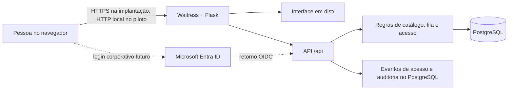

# Agenda de espaços — Costa do Sauípe & Rio Quente

**Estado em 13/10/2026:** piloto local funcional e implantação Docker Compose preparada para Linux. A agenda permite consultar espaços, registrar solicitações, administrar a fila e controlar bloqueios por dia inteiro de **01/01/2026 a 31/12/2028**. O backend Flask serve a interface e a API; o PostgreSQL é a fonte oficial dos dados. O Waitress executa a aplicação. Não é necessário um servidor Node.js para operá-la.

O projeto atende às equipes **Comercial MICE** e **Operacional**. Cada pessoa possui uma conta, uma equipe, um escopo por empreendimento e responsabilidades adicionais quando autorizada. A implantação compartilhada e o login real pelo Microsoft Entra ID ainda dependem de infraestrutura e homologação corporativas. A agenda não está integrada ao Opera Cloud.

## Navegação deste documento

- [Estado da entrega](#estado-da-entrega)
- [Arquitetura e tecnologias](#arquitetura-e-tecnologias)
- [Funcionalidades e regras de negócio](#funcionalidades-e-regras-de-negócio)
- [Modelo de dados](#modelo-de-dados)
- [Autenticação, autorização e segurança](#autenticação-autorização-e-segurança)
- [API e respostas](#api-e-respostas)
- [Executar neste computador](#executar-neste-computador)
- [Executar com Docker no Linux](#executar-com-docker-no-linux)
- [Preparar outra instalação](#preparar-outra-instalação)
- [Operar a agenda](#operar-a-agenda)
- [Pessoas e responsabilidades](#pessoas-e-responsabilidades)
- [Relatórios](#relatórios)
- [Backup e recuperação](#backup-e-recuperação)
- [Testar](#testar)
- [Estrutura e preservação](#estrutura-e-preservação)
- [Implantação compartilhada](#implantação-compartilhada)

## Estado da entrega

| Parte | Situação atual |
| --- | --- |
| Agenda e solicitações | Implementadas e testadas com PostgreSQL; uso local do piloto. |
| Catálogo | 125 linhas de origem importadas, resultando em 99 espaços/configurações. Os empreendimentos foram classificados; a composição física continua a validar. |
| Acesso local | Em uso no piloto: conta e senha individuais, sessões revogáveis e histórico de acesso. |
| Acesso corporativo | Fluxo OIDC com PKCE implementado e retorno simulado testado. Falta registrar a aplicação no tenant, vincular as identidades e homologar o login real. |
| Relatórios e backup | Consulta, CSV, impressão/PDF via navegador, backup e restauração PostgreSQL implementados. |
| Infraestrutura compartilhada | Docker Compose com aplicação, PostgreSQL persistente e proxy HTTPS preparado. Pendente: servidor e domínio corporativos, credenciais Entra, coleta central de logs, monitoramento, rotina de backup e política de retenção. |

Os dois empreendimentos estão identificados: **90 configurações da Costa do Sauípe** e **9 do Rio Quente**. Essa classificação registra a localização administrativa, mas **não homologa a composição física** de salas ou módulos. Uma área hachurada na agenda significa “a validar”; um dia vazio, por si só, não garante disponibilidade. A origem e as decisões de classificação estão em [docs/ANALISE-LISTA-SALAS.md](docs/ANALISE-LISTA-SALAS.md) e nos arquivos de classificação em `docs/`.

## Arquitetura e tecnologias



O navegador carrega arquivos HTML, CSS e JavaScript de `dist/`. O JavaScript consulta a API e envia alterações como JSON. O servidor valida identidade, permissões e regras de negócio antes de gravar. Os dados da agenda ficam no PostgreSQL; `localStorage` é reservado a preferências de exibição. A aplicação oferece `GET /health` para verificar resposta do servidor e conexão com o banco.

| Componente | Versão / papel |
| --- | --- |
| Projeto | `0.1.0` em `pyproject.toml`; identificação interna do piloto, sem homologação de produção. |
| Python | Compatibilidade declarada `>=3.12,<3.14`. Testes passaram em **3.12.4** e **3.13.16** neste computador. |
| Flask | **3.1.3**, fábrica de aplicação, páginas e API. |
| Waitress | **3.0.2**, servidor WSGI do piloto. |
| PostgreSQL | **14.18** validado no piloto local; imagem Docker **17.11** para novas instalações, testada com catálogo e backup. A passagem de uma base 14 para 17 exige migração planejada por backup/restauração, nunca reaproveitamento direto do volume. |
| Imagens Docker | Python **3.13.16** (Debian Trixie), PostgreSQL **17.11** (Trixie) e Caddy **2.10.2**. |
| psycopg com binário | **3.3.6**, conexão e consultas PostgreSQL. |
| Authlib | **1.8.0**, cliente OpenID Connect para o Entra ID. |
| Requests | **2.32.5**, dependência direta do cliente de autenticação. |
| Poetry | Configuração compatível com Poetry 2; **2.5.1** usado para gerar e testar `poetry.lock`. |
| pytest | **9.1.1**, grupo de desenvolvimento. |
| Node.js | **20.16.0** disponível neste computador para testes JavaScript legados; a versão não está fixada para implantação e não participa do servidor da agenda. |

As dependências diretas estão fixadas em `pyproject.toml` e `requirements.txt`. O `poetry.lock` fixa também as dependências indiretas para instalações com Poetry. O projeto usa o modo `package-mode = false`: instalar dependências não publica nem instala a agenda como pacote Python.

## Funcionalidades e regras de negócio

| Tela / função | O que oferece |
| --- | --- |
| **Calendário** | Grade mensal e lista, filtros por empreendimento e situação, pesquisa, indicação de pendências e de ocupação efetiva. No celular, inicia em lista. |
| **Consultar disponibilidade** | Exibe por espaço/período as solicitações pendentes, a fila, a ocupação confirmada e, quando a composição foi validada, as opções físicas disponíveis. |
| **Solicitações & fila** | Criação, consulta, edição e cancelamento de solicitações; ordem de entrada; promoção manual para opção prioritária e confirmação pelo responsável da fila. |
| **Salas & espaços** | Consulta da fonte, classificação por empreendimento/localização, revisão da importação e validação da composição física com registro de evidência. |
| **Pessoas & acessos** | Contas individuais, equipe, escopo, responsabilidades, ativação/desativação, exclusão de acesso e histórico de autenticação para administradores. |
| **Relatórios** | Filtros por período, empreendimento, situação e pesquisa; CSV e impressão, com opção de salvar PDF no navegador. |

Uma **solicitação** contém evento/motivo, responsável, observações e de **1 a 40 alocações**. Cada alocação relaciona uma configuração de espaço, uma fase (`montagem`, `evento` ou `desmontagem`), datas e, se validada, uma opção de recursos físicos. As datas apresentadas ao usuário incluem o último dia; internamente o banco guarda o fim exclusivo, o que simplifica conflitos entre intervalos. Fases repetidas ou sobrepostas não criam dupla ocupação para o mesmo recurso e dia.

| Situação | Efeito e condição principal |
| --- | --- |
| **Pendente de validação** | Registra a demanda mesmo sem composição física homologada; não ocupa recursos nem pode receber opção prioritária. |
| **Em espera** | Entra na fila com composição física válida; não ocupa recursos. |
| **Em opção prioritária** | Concedida manualmente pelo responsável da fila após revalidar prioridade e disponibilidade integral; ocupa recursos. |
| **Confirmado** | Reserva aprovada pelo responsável da fila; ocupa os recursos conhecidos. Excepcionalmente, uma configuração ainda não validada pode ser confirmada sem recursos mapeados: a própria configuração fica bloqueada no período, mas conflitos com outras composições dependem da futura validação física. |
| **Cancelado** | Libera a ocupação e conserva o registro e o histórico; uma nova negociação requer outra solicitação. |

A prioridade considera a **interseção de recursos físicos e dias**, além da mesma configuração. Uma solicitação anterior que permanece integralmente disponível não pode ser ultrapassada por outra que disputa seus recursos. A fila não promove nem expira registros automaticamente. Mudanças de espaços, períodos ou fases de uma espera atribuem uma nova posição; edição apenas de texto preserva a posição. A confirmação é atômica: se uma parte conflitar, nenhuma parte é reservada. A chave única `(resource_id, day)` em `occupations` oferece uma segunda proteção contra dupla ocupação.

O catálogo preserva os 125 códigos da lista recebida. Os códigos **5 e 6** são serviços e ficam fora da agenda. As **28 variantes da Arena Sauípe** são rastreadas sob quatro configurações de uso; não representam 28 salas independentes. A importação recusa mudanças silenciosas em códigos existentes, pode mostrar prévia e não duplica registros. A classificação e a validação da topologia física são operações distintas, com histórico e controle de versão.

**Exemplo do fluxo:** uma pessoa de Comercial MICE registra evento, espaço e períodos de montagem, evento e desmontagem. Se a composição ainda não foi homologada, a solicitação fica pendente de validação e visível para a equipe, sem prometer disponibilidade física. Após a operação validar os recursos e as combinações permitidas, a solicitação pode entrar em espera. O responsável da fila verifica as solicitações anteriores e a ocupação de todos os dias/recursos, concede a opção prioritária e confirma quando autorizado. O bloqueio aparece no calendário e nos relatórios; uma eventual edição ou cancelamento fica no histórico.

## Modelo de dados

As migrações `001_initial.sql`, `002_authentication.sql` e `003_user_deletion.sql` são aplicadas por `flask --app calendar_app init-db`. A tabela `schema_migrations` registra o que já foi executado. Não há SQLite nem armazenamento da agenda no navegador.

| Tabelas | Conteúdo |
| --- | --- |
| `resorts`, `teams`, `users` | Empreendimentos, equipes, contas, escopos, responsabilidades e identidade corporativa vinculada. |
| `source_items`, `imports` | Códigos, texto e versão da lista recebida; rastreio da carga. |
| `configurations`, `resources` | Configurações reserváveis, recursos físicos e opções de composição validadas. |
| `bookings`, `allocations`, `occupations` | Solicitações, fases/períodos e ocupação por recurso/dia. |
| `audit` | Alterações de negócio e cadastro, com autor, horário, ação e dados anteriores/posteriores permitidos. |
| `idempotency` | Chaves de criação para evitar duplicação por reenvio da mesma solicitação. |
| `auth_sessions`, `auth_events`, `login_attempts` | Sessões revogáveis, eventos de segurança e contadores temporários de falhas de login. |

Escritas de negócio ocorrem em transação. O piloto serializa mutações com um bloqueio consultivo do PostgreSQL para revalidar fila, conflitos e topologia no momento de gravar. Registros editáveis usam campo `version`; se alguém os alterou desde a abertura do formulário, a API retorna `409` e pede recarga. Criações de solicitação exigem `Idempotency-Key`: repetir o mesmo envio devolve o mesmo resultado; reutilizar a chave com outro conteúdo é recusado.

## Autenticação, autorização e segurança

### Modos de entrada

- **`local` (piloto atual):** usuário e senha individuais. Novas senhas têm 15 a 128 caracteres, são armazenadas somente como hash gerado pelo Werkzeug e passam por uma lista local inicial de senhas óbvias. O login limita a oito falhas por combinação de origem e usuário em uma janela de dez minutos. Não existe senha padrão. A primeira conta pode ser criada pelo navegador apenas no loopback e quando `CALENDAR_ALLOW_LOCAL_SETUP=1`.
- **`entra` (código preparado, ainda não homologado no tenant):** o navegador é redirecionado ao Microsoft Entra ID pelo fluxo OpenID Connect de código de autorização com PKCE `S256`. Authlib trata o retorno OIDC; a aplicação confere `nonce`, tenant, público e o identificador estável `tid` + `oid`. Só uma pessoa **ativa e previamente vinculada** recebe sessão local. O modo desativa login e troca de senha locais. A agenda não consulta o AD local por LDAP, não recebe senha corporativa e não decide a política de MFA do tenant.

O Active Directory corporativo poderá alimentar as identidades do Entra ID por sincronização gerida pela equipe de identidade. Essa sincronização fica fora deste projeto. A autenticação real com o tenant, a política de atribuição/grupos e o comportamento do logout do SSO precisam ser homologados antes da implantação compartilhada. Veja também [docs/AUTENTICACAO-E-LOGS.md](docs/AUTENTICACAO-E-LOGS.md).

### Sessões e permissões

Após o login, a agenda gera um **token opaco aleatório**. O navegador o recebe em cookie `salas_auth` com `HttpOnly` e `SameSite=Lax`; `Secure` é obrigatório no modo Entra/HTTPS e fica desativado apenas no HTTP local do piloto. O PostgreSQL guarda somente o **hash do verificador**, o usuário, a versão de acesso, o último uso, o vencimento absoluto e a revogação. O token completo não é gravado no banco nem em `localStorage`. Um segundo cookie assinado do Flask (`salas_session`) guarda estado de formulário/CSRF e dados transitórios do fluxo OIDC; ele não substitui a verificação da sessão revogável no banco.

Os padrões atuais são **8 horas de duração absoluta** e **60 minutos sem atividade**, configuráveis. Em cada chamada à API, o servidor verifica token, hash, prazos, revogação, conta ativa e versão de acesso. Logout revoga a sessão no banco. Alterar o acesso ou desativar uma conta revoga suas sessões; trocar a senha local revoga as outras sessões da pessoa. Limpeza de sessões antigas e contadores de tentativa existe no comando `prune-auth`, mas precisa de agendamento operacional.

Escopo e responsabilidades são conferidos no servidor, independentemente dos botões visíveis na interface. A conta comum consulta os empreendimentos de seu escopo e edita/cancela apenas solicitações da própria equipe. `can_catalog` autoriza cadastro e topologia; `can_schedule` concede opção prioritária e confirmação; `can_manage_users` administra pessoas e acessos. O responsável da fila pode promover ou confirmar solicitações de outra equipe no escopo, mas não editar o evento ou cancelá-lo. Um administrador não altera o próprio acesso pela tela.

### Proteções de entrada, navegador e banco

- **SQL injection:** valores de usuário são passados como parâmetros separados às consultas `psycopg`; identificadores de esquema dinâmicos usam `psycopg.sql.Identifier`. Os testes incluem um título com texto de injeção e verificam que ele permanece dado, sem executar SQL.
- **CSRF:** toda operação mutável sob `/api/` exige `X-CSRF-Token` associado ao cookie de sessão do Flask e um objeto JSON válido. Cookies não substituem esse controle.
- **XSS e exportação:** os campos textuais vindos dos dados são escapados ao compor o HTML; o CSV prefixa células que poderiam ser interpretadas como fórmulas por planilhas.
- **Cabeçalhos HTTP:** a aplicação envia política de conteúdo (CSP), `X-Content-Type-Options: nosniff`, `X-Frame-Options: DENY`, política de referência e `Cache-Control: no-store`. Requisições têm `X-Request-ID`; o corpo aceito tem limite de 3 MB.
- **Concorrência:** transações, controle de versão, revalidação no salvamento e chave única de ocupação evitam reservas parciais e dupla ocupação conhecida.

Essas camadas foram testadas no piloto, mas não constituem uma auditoria de segurança externa nem substituem revisão de infraestrutura, proxy, permissões do banco e testes corporativos antes da exposição em rede.

### Registros e retenção

| Registro | Onde fica e como é usado |
| --- | --- |
| `auth_events` | PostgreSQL: entrada aceita ou recusada, limite de tentativas, início/retorno do SSO, saída, mudança de senha, vínculo de identidade, alteração de acesso e recusas `403`. Contém horário, tipo/resultado, usuário quando conhecido, IDs de sessão/requisição, motivo padronizado e hash da origem; não contém senha nem token completo. Administração consulta os 300 eventos mais recentes em **Pessoas & acessos → Histórico de acessos**. |
| `audit` | PostgreSQL: alterações de solicitações, catálogo e pessoas, com histórico por entidade. É separado do histórico de autenticação. |
| `login_attempts` | PostgreSQL: contadores temporários usados para limitar tentativas de senha local. |
| Log técnico | `app.logger` usa JSON com horário UTC, nível, mensagem, caminho e ID da requisição quando disponível; a hospedagem ainda precisa coletar, proteger e girar a saída do processo. |
| Entra ID | Eventos de senha, MFA e acesso condicional pertencem aos registros corporativos do provedor, sob gestão da equipe de identidade. |

O comando `prune-auth` elimina sessões expiradas/revogadas e contadores antigos **após um dia**; ele **não apaga `auth_events`**. Retenção de eventos de acesso, auditoria e backups, monitoramento/alertas, destino central de logs e acesso administrativo devem ser definidos com segurança e privacidade. O backup PostgreSQL inclui os eventos e históricos.

## API e respostas

A interface usa a mesma origem da API. As rotas de autenticação e saúde são exceções públicas; as demais exigem sessão válida e filtram dados pelo escopo da pessoa.

| Grupo | Rotas principais |
| --- | --- |
| Estado e entrada | `GET /health`, `GET /api/session`, `POST /api/setup`, `POST /api/login`, `POST /api/logout`, `POST /api/password`, `GET /api/entra/login`, `GET /api/entra/callback`. |
| Catálogo | `GET /api/catalog`, `GET /api/catalog/sources`, `POST /api/catalog/import`, `POST /api/catalog/classify`, `POST /api/catalog/{id}/topology`, `POST /api/resources`. |
| Solicitações | `GET/POST /api/bookings`, `GET/PUT /api/bookings/{id}`, `POST /api/bookings/{id}/{promote|confirm|cancel}`, `GET /api/availability`, `GET /api/calendar`. |
| Pessoas, histórico e relatório | `GET/POST /api/users`, `PUT /api/users/{id}`, `GET /api/audit/catalog`, `GET /api/audit/auth`, `GET /api/reports.csv`. |

O formato principal é JSON. Em geral, `401` pede novo login, `403` indica permissão/CSRF insuficiente, `409` indica versão desatualizada ou conflito, `422` indica composição não homologada e `503` indica banco indisponível. A API devolve mensagens de erro legíveis; falhas de integridade não expõem detalhes do banco. O calendário limita cada consulta da grade a **62 dias**. O CSV usa UTF-8 com BOM e separador `;`.

## Executar neste computador

O ambiente Python e o banco local já foram preparados. Na pasta `painel`, caso o PostgreSQL local esteja parado:

```sh
pg_ctl -D instance/postgres -l instance/postgres.log -o '-h 127.0.0.1 -p 55432 -k /private/tmp' start
```

Inicie a aplicação:

```sh
.venv/bin/python serve.py
```

Acesse **http://127.0.0.1:4174**. Se a agenda já estiver aberta, não é necessário iniciar outro servidor. `Ctrl+C` encerra a aplicação; o banco permanece ativo. Para encerrar o banco dedicado, use `pg_ctl -D instance/postgres stop` quando não houver usuários conectados.

O banco do piloto já recebeu as três migrações. Antes da migração de autenticação, foi criado o backup local `instance/backups/pre-auth-2026-10-13.dump`; antes da migração de exclusão, `instance/backups/pre-user-deletion-2026-10-13.dump`. O diretório `instance/` e o arquivo `.env` são locais e ignorados pelo Git.

O primeiro acesso cria a conta individual de administração. Escolha uma senha de 15 a 128 caracteres. Frases-senha, espaços e caracteres Unicode são aceitos; não há exigência de misturar tipos de caracteres. O piloto rejeita uma lista local inicial de senhas óbvias e a própria identificação do usuário; uma checagem ampla de credenciais vazadas depende de integração futura com serviço ou lista corporativa. A primeira conta administra cadastros, pessoas e fila; isso não permite editar/cancelar solicitações de outra equipe. Não existe `admin/admin123` na aplicação nova. Senhas já cadastradas continuam válidas no login até que seus titulares as alterem; a nova regra se aplica à criação e à troca de senha.

## Executar com Docker no Linux

Na pasta `painel`, o Docker Compose sobe o PostgreSQL e a aplicação em uma rede interna. A versão local publica a agenda somente em `127.0.0.1:4174`; a versão corporativa acrescenta o Caddy para HTTPS nas portas 80 e 443. O banco não publica porta no servidor. Instale Docker Engine com o plugin Compose e OpenSSL no Linux e reserve espaço persistente para os volumes. O build baixa as imagens e dependências Python; não exige Python, Poetry, Node ou PostgreSQL instalados no host.

### Piloto local com containers

Execute uma única vez para criar dois segredos aleatórios. O script preserva os arquivos se já existirem:

```sh
sh docker/init-secrets.sh
docker compose -f compose.yaml -f compose.local.yaml up -d --build
docker compose -f compose.yaml -f compose.local.yaml ps
```

Abra **http://127.0.0.1:4174** no próprio servidor. Como o cadastro inicial pelo navegador só aceita acesso direto pelo loopback da aplicação, crie o primeiro administrador pelo terminal; o comando pedirá os dados e a senha sem exibi-la:

```sh
docker compose -f compose.yaml -f compose.local.yaml exec app python docker/run.py flask --app calendar_app create-user --admin
```

O volume `postgres_data` guarda a agenda. O volume `app_instance` guarda backups criados dentro do container. Na primeira subida de um banco vazio, a aplicação aplica as migrações, importa as 125 linhas do catálogo e as relações revisadas dos dois empreendimentos. Nas subidas seguintes, verifica as migrações e preserva classificações e alterações existentes. A base Docker é **separada** do PostgreSQL local deste computador; dados do piloto atual exigem backup e restauração planejados antes de uma migração.

Para acompanhar o estado e encerrar os serviços:

```sh
docker compose -f compose.yaml -f compose.local.yaml logs -f app
docker compose -f compose.yaml -f compose.local.yaml down
```

`down` conserva os volumes. Evite `down -v` se houver dados: essa opção remove os volumes do banco e da aplicação. Preserve também `secrets/` e mantenha cópias externas protegidas; trocar `secrets/db_password` depois que o banco foi criado não altera automaticamente a senha interna do PostgreSQL.

### Servidor Linux com HTTPS e Microsoft Entra ID

Crie os dois segredos acima e copie o exemplo de configuração. Em `.env.docker`, substitua o domínio e os IDs pelo registro da aplicação web no tenant. Grave o **segredo do aplicativo Entra** em `secrets/entra_client_secret`, com permissão de leitura restrita ao administrador do servidor; não o coloque no Git nem em `.env.docker`. A URL de retorno registrada no Entra deve ser exatamente `https://SEU_DOMINIO/api/entra/callback`.

```sh
sh docker/init-secrets.sh
cp .env.docker.example .env.docker
```

Edite `.env.docker` e crie `secrets/entra_client_secret` com o valor real. Depois:

```sh
chmod 600 .env.docker secrets/entra_client_secret
docker compose --env-file .env.docker -f compose.yaml -f compose.prod.yaml up -d --build
```

O Caddy obtém e renova o certificado HTTPS automaticamente quando o DNS do domínio aponta para o servidor e as portas 80/443 estão alcançáveis pelo emissor. Se a agenda estiver apenas em rede interna ou usar certificado da organização, a equipe de infraestrutura deve configurar esse certificado no proxy. Não use um domínio fictício para homologar o Entra ID.

Com a stack ativa, vincule a primeira pessoa administradora ao **Object ID** do Entra, ou vincule contas já restauradas conforme [Ativar o login corporativo](#ativar-o-login-corporativo):

```sh
docker compose --env-file .env.docker -f compose.yaml -f compose.prod.yaml exec app python docker/run.py flask --app calendar_app bootstrap-entra --username pessoa@empresa.com --name "Nome da pessoa" --team commercial --object-id UUID-DA-PESSOA
```

Os comandos administrativos no container usam o prefixo `python docker/run.py flask --app calendar_app`; esse auxiliar lê os segredos montados e configura a conexão. `GET /health` verifica a aplicação e o PostgreSQL. `docker compose ... logs` mostra logs técnicos dos containers; autenticações, sessões e alterações continuam registradas no banco nas tabelas descritas adiante. Para operação compartilhada, envie logs técnicos a um coletor central, defina retenção, monitore o endpoint e agende backup PostgreSQL com cópia **fora do host**. O Compose fornece execução e persistência local; a disponibilidade, a política de atualização, o backup e o aceite do login corporativo continuam sob responsabilidade da implantação.

Exemplo de backup manual no modo local Docker; substitua as opções do Compose pelas do modo corporativo quando necessário:

```sh
docker compose -f compose.yaml -f compose.local.yaml exec app python docker/run.py flask --app calendar_app backup-db instance/backups/calendario.dump
docker compose -f compose.yaml -f compose.local.yaml cp app:/app/instance/backups/calendario.dump ./calendario.dump
```

O primeiro arquivo fica no volume `app_instance`; a cópia no diretório atual ainda precisa ser enviada a um armazenamento externo protegido. Use outro nome em cada execução, pois o comando recusa sobrescrever backups. Uma base PostgreSQL 14 existente requer backup e restauração planejada em uma instalação 17 vazia; não monte um volume 14 no serviço 17.

## Preparar outra instalação

Requisitos validados neste piloto: Python 3.12 e 3.13, PostgreSQL 14.18 já existente na máquina e ferramentas `pg_dump`/`pg_restore`. O time deve definir a versão suportada do PostgreSQL para implantação. Dependências diretas fixadas: Flask 3.1.3, psycopg 3.3.6, Waitress 3.0.2.

### Instalar com Poetry

O projeto pode usar Poetry 2 para gerenciar dependências. O arquivo `poetry.lock` fixa as versões resolvidas; o modo sem pacote instala somente as dependências, pois esta agenda é executada diretamente com `serve.py`. Instale o Poetry e, na pasta `painel`, com Python 3.13 disponível:

```sh
export POETRY_VIRTUALENVS_IN_PROJECT=false
export POETRY_VIRTUALENVS_PATH="$PWD/instance/poetry-envs"
poetry env use python3.13
poetry sync
```

As duas variáveis mantêm o ambiente do Poetry separado do `.venv` preexistente. Neste computador, o executável do Poetry está em `instance/poetry-cli/bin/poetry`; use esse caminho no lugar de `poetry` se ele não estiver no `PATH`. Para os comandos administrativos, use `poetry run flask --app calendar_app <comando>`. O ambiente de desenvolvimento local que já usa `.venv` pode continuar com `pip`; mantenha as versões de `requirements*.txt` e `pyproject.toml` alinhadas ao atualizar dependências.

### Instalar com pip

```sh
python3 -m venv .venv
.venv/bin/python -m pip install -r requirements.txt
```

Com qualquer um dos gerenciadores, copie o exemplo de configuração **somente em uma instalação nova**, crie um banco PostgreSQL dedicado e ajuste `DATABASE_URL` no `.env`. Preserve o `.env` preexistente. A aplicação não cria um serviço de banco corporativo. O papel do banco precisa executar as migrações iniciais; em implantação, separe o papel de migração do papel de execução conforme a política da equipe.

```sh
cp .env.example .env
.venv/bin/flask --app calendar_app init-db
.venv/bin/flask --app calendar_app import-catalog docs/catalogo-salas-preliminar.json --preview
.venv/bin/flask --app calendar_app import-catalog docs/catalogo-salas-preliminar.json
.venv/bin/python serve.py
```

Os comandos acima usam o caminho do ambiente `pip`; com Poetry, substitua `.venv/bin/flask` por `poetry run flask` e `.venv/bin/python` por `poetry run python`. `init-db` aplica apenas migrações ainda não registradas. A importação é transacional e repetível sem duplicar itens ou substituir revisões já feitas. O auxiliar `scripts/prepare_local.py` é exclusivo do banco local chamado `calendario`.

### Relação revisada da Costa do Sauípe

O arquivo `docs/classificacao-costa-sauipe-2026-10-08.json` registra os códigos da fonte associados à lista enviada pelo usuário e às confirmações posteriores de Bahia 1–2 e das quatro configurações de São Tomé. Há 114 linhas da fonte que representam 90 configurações da agenda, pois 28 variantes da Arena compartilham quatro configurações. Os serviços 5 e 6 continuam fora da agenda. A classificação é auditada e preserva IDs, localização, solicitações e validação física. Pode ser repetida sem duplicar alterações.

```sh
.venv/bin/flask --app calendar_app classify-reviewed docs/classificacao-costa-sauipe-2026-10-08.json
.venv/bin/flask --app calendar_app backup-db instance/backups/antes-classificacao-sauipe.dump
.venv/bin/flask --app calendar_app classify-reviewed docs/classificacao-costa-sauipe-2026-10-08.json --apply
```

Sem `--apply`, o comando apenas mostra uma prévia. Ele recusa classificar parcialmente uma configuração compartilhada, como a Arena, ou mover para Sauípe um item já atribuído ao Rio Quente. Após a aplicação da relação de Sauípe, nove configurações da relação do Rio Quente aguardam classificação. As quatro configurações de São Tomé foram confirmadas para Sauípe por mensagem posterior; a segunda linha escrita como “São Tomé 1–2” no texto inicial descrevia 1–2–3. “Santa Amaro” foi associado ao nome original “Santo Amaro”, preservado no catálogo.

### Relação revisada do Rio Quente

O arquivo `docs/classificacao-rio-quente-2026-10-08.json` identifica Gardênia, Canário, Aimorés, Amazonas, três configurações de união do grupo, Jubarte e Maremoto: nove configurações no total. Execute após a classificação da Costa do Sauípe. Os códigos omitidos na segunda relação só são aceitos quando já têm empreendimento, evitando deixar itens sem destino por engano.

```sh
.venv/bin/flask --app calendar_app classify-reviewed docs/classificacao-rio-quente-2026-10-08.json
.venv/bin/flask --app calendar_app backup-db instance/backups/antes-classificacao-rio-quente.dump
.venv/bin/flask --app calendar_app classify-reviewed docs/classificacao-rio-quente-2026-10-08.json --apply
```

Depois das duas relações, são 90 configurações da Costa do Sauípe e nove do Rio Quente; todas têm empreendimento. As composições físicas de São Tomé e dos conjuntos de dois e três módulos do Rio Quente continuam sem validação operacional. A classificação do empreendimento, sozinha, não libera bloqueios efetivos.

Configuração:

| Variável | Uso |
| --- | --- |
| `DATABASE_URL` | Conexão PostgreSQL; mantenha credenciais fora do Git |
| `CALENDAR_PORT` | Porta local, padrão 4174 |
| `CALENDAR_SECRET_KEY` | Chave persistente de sessão; sem essa variável, usa `instance/secret-key` |
| `CALENDAR_SECURE_COOKIES` | `1` sob HTTPS; `0` no HTTP local |
| `CALENDAR_ALLOW_LOCAL_SETUP` | `1` permite primeiro acesso pelo loopback; use `0` após criar a conta e antes de expor por proxy |
| `CALENDAR_AUTH_MODE` | `local` no piloto ou `entra` para login corporativo |
| `CALENDAR_AUTH_SESSION_HOURS`, `CALENDAR_AUTH_IDLE_MINUTES` | Prazo absoluto e limite de inatividade da sessão; padrões provisórios de 8 horas e 60 minutos |
| `ENTRA_TENANT_ID`, `ENTRA_CLIENT_ID`, `ENTRA_CLIENT_SECRET` | Registro da aplicação web no tenant Microsoft Entra ID |
| `ENTRA_REDIRECT_URI` | URL HTTPS registrada no Entra ID, terminada em `/api/entra/callback` |

### Ativar o login corporativo

Peça à equipe de identidade o **Tenant ID**, **Client ID**, segredo do aplicativo e registro da URL de retorno da agenda como aplicação web. Configure `CALENDAR_AUTH_MODE=entra`, `CALENDAR_SECURE_COOKIES=1`, `CALENDAR_ALLOW_LOCAL_SETUP=0` e as quatro variáveis `ENTRA_*` no ambiente do servidor, sob HTTPS. Execute `init-db` antes de ativar o novo código na base existente. A aplicação recusa iniciar esse modo se faltar configuração ou HTTPS.

Em uma base nova, vincule a primeira pessoa administradora pelo Object ID do Entra ID:

```sh
.venv/bin/flask --app calendar_app init-db
.venv/bin/flask --app calendar_app bootstrap-entra --username pessoa@empresa.com --name "Nome da pessoa" --team commercial --object-id UUID-DA-PESSOA
```

Em uma base que já tem usuários do piloto, vincule cada registro existente para preservar seu ID e histórico:

```sh
.venv/bin/flask --app calendar_app link-entra --username usuario-existente --object-id UUID-DA-PESSOA
```

No modo corporativo, o login e a troca de senha locais ficam desativados. A administração pode cadastrar novas pessoas com o Object ID do Entra ID, equipe, empreendimento e responsabilidades. Apenas identidades vinculadas e ativas acessam a agenda; o retorno do provedor não concede permissão automaticamente. `auth_sessions` guarda somente hash do verificador do token, `auth_events` guarda os eventos de acesso e `audit` mantém o histórico de alterações. Administradores consultam os 300 eventos de acesso mais recentes em `GET /api/audit/auth`; a limpeza de sessões e contadores vencidos pode ser agendada com `flask --app calendar_app prune-auth`. O prazo de retenção de `auth_events` depende da política da organização.

Não sobrescreva um `.env` existente. Proteja o arquivo e `instance/secret-key`, com leitura restrita ao usuário do serviço. Variáveis já definidas no processo têm precedência sobre `.env`.

## Operar a agenda

1. Em **Salas & espaços**, consulte nomes, códigos da fonte e observações. As 125 linhas do PDF geram 99 espaços/configurações para revisão e 63 candidatos a recursos físicos. Os dois serviços ficam fora da agenda. As 28 variantes da Arena ficam rastreáveis sob quatro configurações, sem disponibilidade independente por fase ou climatização.
2. Use **Validar composição** somente após confirmação da operação. A sugestão extraída do nome não é homologação. Para Arena, cadastre os módulos físicos identificados e depois vincule os conjuntos permitidos. Configurações sem validação aceitam solicitações pendentes e confirmações feitas pelo responsável da fila. Nestas confirmações, o bloqueio garante exclusividade da configuração escolhida; conflitos com outras configurações combinadas dependem da validação física.
3. Para atribuir resort e localização, selecione um ou mais itens e clique em **Classificar seleção**. A tela mostra os itens que serão alterados. Registre a referência da classificação. Os IDs, as solicitações e o histórico são preservados.
4. Em **Nova solicitação**, informe evento/motivo, responsável, espaços, fases e datas. Inclua montagem e desmontagem como períodos. A equipe proprietária vem da conta. A data final é inclusiva; a aplicação aceita 29/02/2028 e passagens entre meses/anos.
5. Uma solicitação em espera entra na fila por ordem de entrada. O responsável da fila concede manualmente a opção prioritária após verificar o conjunto inteiro. Ele também pode confirmar a reserva na tela da solicitação ou marcar **Confirmar reserva e bloquear o espaço** ao salvar uma solicitação da própria equipe. A confirmação bloqueia todos os espaços e dias da solicitação de forma atômica: se algum já estiver reservado, nada é confirmado. **Consultar disponibilidade** mostra as datas das solicitações e dos bloqueios, distinguindo pendências de reservas confirmadas e indicando ocupações de configurações compartilhadas.
6. Apenas o responsável da fila confirma bloqueios. A equipe proprietária pode editar os dados do seu registro e cancelar com motivo; alterações de espaço ou período já confirmados exigem o responsável da fila. O cancelamento libera a ocupação e mantém histórico. A fila não avança nem expira automaticamente.

As condições de cada situação e o tratamento da confirmação sem topologia validada estão descritos em [Funcionalidades e regras de negócio](#funcionalidades-e-regras-de-negócio). Expansões de uma opção ou confirmação revalidam conflitos e prioridade nos novos dias e recursos.

Os filtros exibem **Todos**, **Costa do Sauípe** e **Rio Quente**. A categoria provisória de identificação foi retirada da interface após a classificação dos 99 espaços/configurações. O valor vazio permanece apenas como estado interno para uma eventual importação futura; um responsável cadastral precisa atribuir um dos dois empreendimentos antes de criar novos recursos ou alterar a classificação pela aplicação. Os conflitos continuam usando recursos físicos globais.

Na grade, hachura significa **a validar**, ponto indica ocupação efetiva e o contador mostra solicitações pendentes/em espera. A lista apresenta a situação por texto e cor. O filtro de situação filtra solicitações; ele nunca esconde ocupações físicas para fazer um dia parecer livre. O celular abre em lista. A atualização consulta o servidor a cada 20 segundos quando nenhum formulário/campo está em edição; também há **Atualizar agenda**. Falhas de conexão são sinalizadas.

**Consultar disponibilidade** mostra separadamente a ocupação efetiva e a quantidade de solicitações pendentes ou em espera que intersectam o período. Uma solicitação pendente, como a de uma configuração ainda não validada, fica visível na consulta, mas não aparece como bloqueio confirmado. A opção prioritária ocupa recursos físicos; a confirmação os ocupa quando já foram mapeados. Uma confirmação sem composição validada bloqueia a configuração exata, com a limitação de conflitos entre composições explicada acima.

## Pessoas e responsabilidades

Em **Pessoas & acessos**, a administração cria contas individuais, seleciona a equipe e define o escopo: Costa do Sauípe e/ou Rio Quente. Ao adicionar uma pessoa ou abrir **Ajustar acesso**, pode marcar **Administrador de acessos**. Quem recebe esse papel pode adicionar pessoas, conceder ou revogar acessos, designar outros administradores e excluir membros. Sem esse papel, essas ações são negadas também pelo servidor. A mudança encerra as sessões antigas; a pessoa deve entrar novamente para usar as novas permissões. O administrador não altera o próprio acesso pela tela.

A administração pode desativar contas e escolher **Excluir pessoa** com confirmação. A exclusão encerra as sessões, retira a pessoa da lista e libera o nome de usuário e o vínculo Entra para um novo cadastro. O administrador não pode excluir a própria conta. A linha interna da pessoa excluída permanece desativada e com nome genérico para preservar as chaves de solicitações, sessões e auditoria; o evento da exclusão registra quem executou a ação e os dados anteriores. Portanto, excluir o acesso não equivale a apagar o histórico ou a executar uma solicitação de eliminação de dados pessoais. A equipe da conta não é um campo livre de edição de bloqueios.

- Usuário comum: consulta seu escopo e altera solicitações da própria equipe.
- Responsável cadastral: classifica espaços, revisa composições e importa a lista. Isso não concede edição de outra equipe.
- Responsável da fila: concede a opção prioritária às solicitações elegíveis no seu escopo, inclusive de outra equipe. Não pode editar o evento nem cancelar essa outra equipe.
- Administração de acessos: administra contas e escopos. Não altera o próprio acesso pela tela.

Os nomes das pessoas responsáveis por cadastro e fila devem ser designados pela operação. O piloto usa contas locais; quando o modo Entra ID for ativado, a recuperação de senha ficará com a identidade corporativa.

Criação administrativa por terminal, com senha solicitada sem exibição:

```sh
.venv/bin/flask --app calendar_app create-user --admin
```

## Relatórios

Selecione empreendimento, situação, pesquisa e período em **Relatórios**. São incluídas as alocações que intersectam os filtros e as datas. O CSV usa UTF-8 com BOM, ponto e vírgula e neutralização de fórmulas. **Imprimir / PDF** prepara o relatório e abre a impressão do navegador; escolha salvar como PDF. CSV é uma consulta legível, não um backup completo.

## Backup e recuperação

Use ferramentas PostgreSQL compatíveis com a versão do servidor, disponíveis no PATH. O backup inclui cadastros, contas com hashes, solicitações, ocupações, histórico e migrações do esquema da aplicação. Não inclui arquivos, papéis globais do PostgreSQL ou configuração de infraestrutura. Guarde separadamente o código, `.env` e a chave de sessão em local protegido. Defina retenção e cópia externa com o time antes do uso compartilhado; não há agendamento automático nesta entrega.

```sh
.venv/bin/flask --app calendar_app backup-db instance/backups/calendario-2026-10-07.dump
```

O comando recusa sobrescrever arquivos existentes. O arquivo é criado com permissões restritas. Faça backup antes de migrações.

Para recuperar, o administrador cria **outro banco vazio**, configura `RESTORE_DATABASE_URL` com a conexão desse destino no ambiente do terminal e executa:

```sh
.venv/bin/flask --app calendar_app restore-db instance/backups/calendario-2026-10-07.dump
```

A restauração usa uma única transação e recusa banco que já contenha tabelas de aplicação. Confira contagens, histórico e ocupações no destino. Só depois interrompa a aplicação, troque `DATABASE_URL` e reinicie. Preserve a origem até encerrar a validação. O teste automatizado realiza backup e restauração reais em bancos temporários, incluindo proteção contra sobrescrita.

## Testar

```sh
.venv/bin/python -m pip install -r requirements-dev.txt
.venv/bin/python -m pytest tests_python -q --tb=short
node --test tests/model.test.mjs
node --check dist/js/calendar.js
```

Os testes Python criam esquemas isolados por teste no `TEST_DATABASE_URL` ou, na ausência dele, no `DATABASE_URL`. Os testes de recuperação criam e removem bancos temporários com prefixo de teste, exigindo `CREATEDB`; execute-os em ambiente de desenvolvimento. Não há SQLite. Node é usado apenas para verificar JavaScript e os nove testes preservados do painel anterior.

**Validação em 13/10/2026:** 54 testes Python e 9 testes Node passaram. A suíte cobre regras de fila e conflito, datas, autorização e CSRF, sessões/revogação, registro de login, tentativa de SQL injection, importação/classificação, backup/restauração, concessão e revogação do papel de administrador, exclusão de acesso e um retorno Entra ID simulado. `poetry check --lock` aprovou a configuração anterior das dependências. Isso **não equivale** a um teste real contra o tenant corporativo nem a um ensaio de carga.

A stack Docker foi construída e executada no Docker Desktop (containers Linux ARM64) com PostgreSQL 17.11. Aplicação e banco ficaram saudáveis; `/health` respondeu; as 99 configurações foram classificadas; reiniciar a aplicação não duplicou dados; backup e cópia do arquivo funcionaram. O arquivo do Caddy passou na validação de configuração. Ainda falta executar a stack em um servidor Linux da equipe, com domínio e login Entra reais.

Para uma prévia visual descartável, `scripts/qa_preview.py` cria um esquema separado, disponibiliza a porta 4175 apenas no loopback e exibe aviso de dados fictícios. As contas e validações de teste nunca são inseridas no esquema operacional. O script limpa seu próprio esquema ao ser encerrado normalmente. Não use essa prévia como ambiente de equipe.

## Estrutura e preservação

- `calendar_app/`: fábrica Flask, autenticação, regras cadastrais e de bloqueios, API, persistência e comandos administrativos.
- `calendar_app/migrations/`: migrações PostgreSQL versionadas.
- `dist/`: interface adaptada, estilos originais reaproveitados e comunicação assíncrona com a API.
- `docs/`: proposta, análise da fonte, catálogo preliminar e relatório de implementação.
- `tests_python/`: testes de integração com banco e API.
- `pyproject.toml`, `poetry.lock`, `requirements*.txt`: metadados, versões e instalação das dependências Python.
- `serve.py`, `.env.example`, `scripts/`: entrada local, exemplo de configuração e utilitários de preparação/prévia.
- `Dockerfile`, `compose*.yaml`, `docker/`, `.env.docker.example`: imagens, execução em containers, proxy e configuração de referência. `secrets/` contém segredos locais e é ignorado pelo Git.
- `instance/`, `.env`, `.venv/`: banco, backups, segredos e ambientes locais; não são publicados no Git.
- `legacy/`: cópia preservada do painel anterior, incluindo seu servidor estático e instruções históricas.

O painel antigo pode ser consultado em `/legacy/`. Os dados `localStorage` pertencem à origem e ao perfil do navegador: a nova porta não copia os dados da antiga. Para recuperar uma base antiga, execute `node legacy/server.mjs` na porta original e exporte o JSON pelo próprio painel. Não importe exemplos como reservas. Uma migração real exige mapeamento e validação explícitos.

## Implantação compartilhada

A aplicação usa `create_app`, Blueprints e Waitress com depuração desativada. `serve.py` escuta apenas `127.0.0.1` e atende ao piloto sem Docker. O Compose publica a aplicação apenas no loopback no modo local; no modo corporativo, o Caddy recebe HTTPS e conecta-se ao Waitress pela rede interna. O endpoint `/health` consulta o banco e deve integrar o monitoramento definido pela equipe.

| Decisão para a equipe | O que precisa ser concluído |
| --- | --- |
| Hospedagem | Provisionar servidor Linux, DNS, rede, HTTPS, disponibilidade e atualização da stack Compose. Validar o domínio real e o certificado do Caddy. |
| Banco e migrações | Homologar o PostgreSQL 17.11 da imagem, separar papéis de migração/execução e definir atualização com backup anterior. O Compose atual usa um único papel para inicializar e operar. |
| Identidade | Registrar a aplicação no Entra ID, configurar segredo e URL de retorno, vincular `tid` + `oid` às pessoas autorizadas e testar contas ativas/inativas, MFA e políticas do tenant. |
| Sessões e acesso | Aprovar prazos de 8 horas/60 minutos ou seus substitutos, comportamento de saída do SSO, tratamento de contas desativadas no diretório e responsáveis por cada permissão. |
| Catálogo físico | Validar módulos, uniões permitidas e evidências com a operação, sobretudo Arena, São Tomé e conjuntos do Rio Quente. Revisar confirmações já lançadas em configurações não validadas. |
| Observabilidade e retenção | Coletar e proteger logs técnicos, definir alertas, acesso aos registros, duração de `auth_events`/`audit`, rotação e descarte. Agendar `prune-auth`. |
| Continuidade | Agendar backup, guardar cópia externa protegida e ensaiar restauração para banco vazio. |
| Aceite | Executar testes funcionais com ambas as equipes, teste real do Entra ID e avaliação de volume/desempenho. |

Antes da exposição, configure `CALENDAR_SECURE_COOKIES=1`, `CALENDAR_ALLOW_LOCAL_SETUP=0`, uma chave de sessão persistente e o modo de autenticação aprovado. A aplicação recusa iniciar em modo Entra sem HTTPS e os dados obrigatórios do registro. O volume e o desempenho em produção não foram medidos. Não há implantação pública nem integração com Opera Cloud nesta entrega.

## Identidade visual Aviva — 8 de outubro de 2026

O logo e o fundo fornecidos pelo solicitante estão em `dist/assets/aviva-logo.png` e `dist/assets/aviva-background.jpg`, preservados integralmente. O tema em `dist/aviva.css` aplica azul-petróleo, ciano, verde, lima e laranja ao acesso, menu, botões e indicadores, com superfícies brancas para formulários e calendário. As cores são baseadas nas imagens recebidas; não foi fornecido um manual de marca. O tema fica separado dos estilos de estrutura para facilitar manutenção.

Logo com proporção original, leitura em computador/celular, ausência de transbordamento horizontal e carregamento dos arquivos conferidos no navegador durante a revisão visual. Prévias dessa etapa: `docs/aviva-login-desktop.jpg`, `docs/aviva-login-mobile.jpg` e `docs/aviva-calendar-desktop.jpg`.
